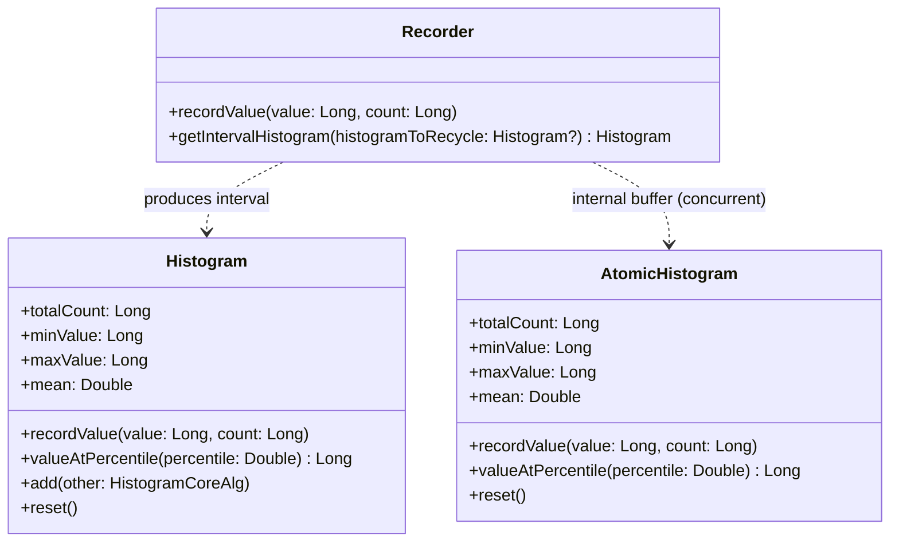

Español | [English](README.md) | [中文](README.zh-CN.md) 

# HdrHistogram-Kotlin

[](https://kotlinlang.org)
[](https://kotlinlang.org/docs/multiplatform.html)
[](http://www.apache.org/licenses/LICENSE-2.0)
[](https://central.sonatype.com/artifact/io.github.dsqrwym/hdrhistogram-kotlin)

> Nota: El borrador inicial de este README fue generado por IA (Antigravity) a partir de pruebas de rendimiento (benchmarks) en hardware real y análisis de la arquitectura del código fuente, y posteriormente revisado y ajustado por el autor del proyecto.

**HdrHistogram-Kotlin** es una biblioteca de histogramas de alto rango dinámico (High Dynamic Range, HDR) y alto rendimiento diseñada específicamente para [Kotlin Multiplatform (KMP)](https://kotlinlang.org/docs/multiplatform.html), comparada con y basada en la implementación nativa oficial en Java de Gil Tene [HdrHistogram](https://github.com/HdrHistogram/HdrHistogram).

Permite registrar y analizar eficazmente la distribución de valores de datos muestreados en un rango configurable de números enteros con **precisión relativa configurable** (dígitos significativos). Está diseñada para escenarios sensibles a la latencia como monitorización de rendimiento, APM, pruebas de red y métricas del sistema.

---

## Contenido

- [Características principales](#características-principales)
- [¿Por qué un histograma HDR?](#por-qué-un-histograma-hdr)
- [Plataformas compatibles](#plataformas-compatibles)
- [Arquitectura y API principal](#arquitectura-y-api-principal)
- [Guía de inicio rápido](#guía-de-inicio-rápido)
  - [1. Histograma monohilo básico (Histogram)](#1-histograma-monohilo-básico-histogram)
  - [2. Registro concurrente sin bloqueos (Recorder)](#2-registro-concurrente-sin-bloqueos-recorder)
  - [3. Histograma atómico multihilo (AtomicHistogram)](#3-histograma-atómico-multihilo-atomichistogram)
- [Pruebas de rendimiento (Informe de Benchmarks)](#pruebas-de-rendimiento-informe-de-benchmarks)
  - [Entorno de pruebas y metodología](#entorno-de-pruebas-y-metodología)
  - [Consistencia entre sesiones (lo que de verdad se reproduce)](#consistencia-entre-sesiones-lo-que-de-verdad-se-reproduce)
  - [1. Comparativa de rendimiento en JVM (Throughput - Media de 3 forks)](#1-comparativa-de-rendimiento-en-jvm-throughput---media-de-3-forks)
  - [2. Comparativa de latencia de escritura en JVM (Latency - Media de 3 forks)](#2-comparativa-de-latencia-de-escritura-en-jvm-latency---media-de-3-forks)
  - [3. Consumo de memoria y pruebas de cero asignación GC (Memory Footprint & Zero Allocation)](#3-consumo-de-memoria-y-pruebas-de-cero-asignación-gc-memory-footprint--zero-allocation)
  - [4. Tiempo de consulta de estadísticas y reinicio en JVM](#4-tiempo-de-consulta-de-estadísticas-y-reinicio-en-jvm)
  - [5. Rendimiento multiplataforma KMP (JVM vs WasmJS vs JS)](#5-rendimiento-multiplataforma-kmp-jvm-vs-wasmjs-vs-js)
- [Comandos para reproducir los benchmarks](#comandos-para-reproducir-los-benchmarks)
- [Análisis de rendimiento a bajo nivel y comparativa de diseño](#análisis-de-rendimiento-a-bajo-nivel-y-comparativa-de-diseño)
  - [Dónde aparecen las ventajas y por qué](#dónde-aparecen-las-ventajas-y-por-qué)
  - [Dónde las desventajas no lo son](#dónde-las-desventajas-no-lo-son)
- [Agradecimientos y Licencia](#agradecimientos-y-licencia)

---

## Características principales

- **Complejidad constante en tiempo y espacio**: El espacio de memoria físico es constante, definido exclusivamente por el rango de valores y la precisión configurados en la construcción; **cero asignaciones en memoria (Zero GC / Allocation-free)** durante el registro de valores, sin sobrecarga de listas enlazadas, tablas hash o redimensionamiento dinámico de arrays.
- **Direccionamiento a nivel de bits sin bifurcaciones**: Calcula los índices de los buckets y sub-buckets directamente utilizando `countLeadingZeroBits` (instrucción CLZ del hardware del procesador) y máscaras de bits, eliminando bifurcaciones condicionales `if` en las rutas críticas de ejecución.
- **Concurrencia eficiente y doble búfer**:
  - El componente `Recorder` con doble búfer se basa en un sincronizador de rotación de dos fases (`WriterReaderPhaser`). Los hilos escritores registran valores con un único incremento atómico, mientras que los hilos lectores cambian de fase periódicamente para extraer instantáneas de intervalos sin bloquear a los escritores.
  - `AtomicHistogram` aprovecha instrucciones atómicas a nivel de bus de CPU (XADD / LDADD) para admitir escrituras multihilo altamente concurrentes.
- **Soporte nativo para Kotlin Multiplatform**: Una única base de código cubre JVM, Android, Linux (x64), macOS/iOS (Native), WebAssembly (WasmJS) y JavaScript.

---

## ¿Por qué un histograma HDR?

En la monitorización del rendimiento de sistemas (como SLAs, latencia de servicios o duración de transacciones), **las medias suelen ocultar las latencias de cola críticas** (por ejemplo, picos de latencia en los percentiles 99.9% o 99.99%).

Los histogramas tradicionales utilizan buckets lineales de ancho fijo (lo que provoca una explosión de memoria en rangos dinámicos amplios) o buckets logarítmicos de grano grueso (lo que deteriora drásticamente la resolución en valores altos).

**La solución de los histogramas HDR**:
Dividen los rangos de forma adaptativa basándose en un número configurado de **dígitos significativos (Significant Value Digits)**:
- Por ejemplo, configurando una precisión de `3` (garantizando una resolución relativa superior al 0.1%):
  - En el rango de $1\,\mu\text{s} \sim 2\,\text{ms}$, la resolución es de $1\,\mu\text{s}$;
  - En el rango de $2\,\text{ms} \sim 2\,\text{s}$, la resolución es de $1\,\text{ms}$;
  - En el rango de $2\,\text{s} \sim 2,000\,\text{s}$, la resolución es de $1\,\text{s}$.
- Independientemente de la magnitud del valor medido, **el error de medición se mantiene estrictamente por debajo del 0.1%**, mientras que el histograma completo ocupa solo entre unas decenas y unos cientos de kilobytes de memoria física.

---

## Plataformas compatibles

| Destino (Target) | Entorno / Arquitectura | Implementación de Concurrencia |
| :--- | :--- | :--- |
| **JVM** | Java 11+ / OpenJDK | Operaciones atómicas + `Thread.onSpinWait()` + Phaser de doble búfer |
| **Android** | Android 7.0+ (API 24+) | Operaciones atómicas + Phaser de doble búfer |
| **Native** | Linux (x64), iOS (Arm64/Simulator) | POSIX / Operaciones atómicas + ensamblador en línea `pause`/`yield` |
| **WasmJS** | WebAssembly (Node.js / Navegador) | Doble búfer eficiente monohilo |
| **JS** | JavaScript (Node.js / Navegador) | Doble búfer eficiente monohilo |

---

## Arquitectura y API principal



1. **[`Histogram`](#1-histograma-monohilo-básico-histogram)**: Histograma base no seguro para subprocesos con velocidad de registro en nanosegundos; ideal para uso monohilo, corrutinas confinadas o agregación de datos por lotes.
2. **[`AtomicHistogram`](#3-histograma-atómico-multihilo-atomichistogram)**: Histograma sin bloqueos diseñado para escritura concurrente multihilo, respaldado por arrays atómicos.
3. **[`Recorder`](#2-registro-concurrente-sin-bloqueos-recorder)**: Registrador de doble búfer optimizado para el rendimiento (throughput). Los hilos de trabajo escriben sin bloqueos mientras un hilo en segundo plano extrae periódicamente instantáneas de intervalo sin detener a los escritores.

---

## Guía de inicio rápido

### Agregar dependencia

Añade la dependencia a tu archivo `build.gradle.kts`:

```kotlin
repositories {
    mavenCentral()
}

kotlin {
    sourceSets {
        commonMain.dependencies {
            implementation("io.github.dsqrwym:hdrhistogram-kotlin:0.0.2")
        }
    }
}
```

### 1. Histograma monohilo básico (Histogram)

Adecuado para recolección monohilo, análisis de registros fuera de línea o como contenedor de agregación:

```kotlin
import io.github.dsqrwym.hdrhistogram.Histogram

// Crear un histograma: valor mínimo identificable 1ns, valor máximo rastreable 1 hora (3.6e12 ns), 3 dígitos significativos (0.1% de precisión)
val histogram = Histogram(
    lowestDiscernibleValue = 1L,
    highestTrackableValue = 3_600_000_000_000L,
    numberOfSignificantValueDigits = 3
)

// Registrar medidas de latencia (nanosegundos)
histogram.recordValue(1_500L)
histogram.recordValue(25_000L)
histogram.recordValue(100_000L, count = 10L) // Registrar en lote 10 veces

// Consultar métricas clave
println("Muestras totales: ${histogram.totalCount}")
println("Valor mínimo:     ${histogram.minValue} ns")
println("Valor máximo:     ${histogram.maxValue} ns")
println("Media:            ${histogram.mean} ns")
println("Mediana P50:      ${histogram.valueAtPercentile(50.0)} ns")
println("Percentil P99:    ${histogram.valueAtPercentile(99.0)} ns")
println("Percentil P99.9:  ${histogram.valueAtPercentile(99.9)} ns")

// Reiniciar el histograma (sin volver a asignar memoria)
histogram.reset()
```

### 2. Registro concurrente sin bloqueos (Recorder)

Recomendado para escenarios con registro continuo de alto rendimiento (p. ej. pasarelas API, servicios RPC, motores de trading) y generación periódica de métricas:

```kotlin
import io.github.dsqrwym.hdrhistogram.Recorder
import io.github.dsqrwym.hdrhistogram.Histogram
import kotlinx.coroutines.*
import kotlin.time.Duration.Companion.milliseconds

val recorder = Recorder(
    lowestDiscernibleValue = 1_000L,         // 1 microsegundo
    highestTrackableValue = 60_000_000_000L, // 60 segundos
    numberOfSignificantValueDigits = 3
)

// Simular múltiples hilos o corrutinas de escritura concurrentes
repeat(8) {
    CoroutineScope(Dispatchers.Default).launch {
        while (isActive) {
            val latencyNs = measureRequestTime()
            recorder.recordValue(latencyNs)
        }
    }
}

// Hilo independiente para recolección y reporte periódico de métricas (p. ej. cada 10 ms)
CoroutineScope(Dispatchers.Default).launch {
    // Pasar null la primera vez asignará una instancia de Histogram en memoria;
    // En las siguientes iteraciones, pasar la misma instancia la reutiliza tras limpiarla, con cero asignaciones para el recolector de basura (GC).
    var recycleHistogram: Histogram? = null
    while (isActive) {
        delay(10.milliseconds)
        
        // Alternar fase y obtener de forma fluida el histograma del intervalo, reutilizando la instancia anterior
        recycleHistogram = recorder.getIntervalHistogram(recycleHistogram)
        
        println("Peticiones en intervalo: ${recycleHistogram.totalCount}, " +
                "P99: ${recycleHistogram.valueAtPercentile(99.0)} ns, " +
                "P99.9: ${recycleHistogram.valueAtPercentile(99.9)} ns")
    }
}
```

### 3. Histograma atómico multihilo (AtomicHistogram)

Para casos donde múltiples hilos escriben concurrentemente en el mismo histograma:

```kotlin
import io.github.dsqrwym.hdrhistogram.AtomicHistogram

val atomicHistogram = AtomicHistogram(
    lowestDiscernibleValue = 1L,
    highestTrackableValue = 10_000_000L,
    numberOfSignificantValueDigits = 3
)

// Se puede invocar de forma concurrente desde cualquier hilo; utiliza instrucciones atómicas de CPU
atomicHistogram.recordValue(12345L)
```

> **Aviso importante**:
> La atomicidad de `AtomicHistogram` **solo garantiza la seguridad en la escritura multihilo** (sin pérdida de datos ni condiciones de carrera).
> Sin embargo, durante lecturas concurrentes (como invocar `valueAtPercentile`), **no proporciona una instantánea atómica globalmente consistente a través de todos los buckets** (los hilos escritores pueden actualizar buckets posteriores mientras la lectura recorre el array).
> **En entornos de producción que requieran lecturas consistentes periódicas junto a escrituras de alta frecuencia, utilice siempre `Recorder`**.

---

## Pruebas de rendimiento (Informe de Benchmarks)

Con el fin de ofrecer información técnica rigurosa y objetiva, comparamos **este proyecto** con la **biblioteca nativa oficial en Java (`org.hdrhistogram:HdrHistogram:2.2.2`)** bajo el mismo hardware y entorno de ejecución (incluyendo la lógica de comparación 1:1 de Gil Tene, modelos de carga representativos y mediciones de memoria).

### Entorno de pruebas y metodología

- **Procesador (CPU)**: AMD Ryzen 5 7530U with Radeon Graphics (6 núcleos / 12 subprocesos, base 2.0 GHz, turbo 4.5 GHz)
- **Memoria (RAM)**: 16 GB DDR4 (15.3 GB utilizables)
- **Sistema operativo**: Windows 11 64-bit (build 26300)
- **Entorno de ejecución Java**: Eclipse Temurin 25.0.3 (OpenJDK HotSpot, build 25.0.3+9-LTS)
- **Entorno de ejecución Node.js**: v24.15.0 (usado para pruebas JS y WasmJS)
- **Framework de benchmark**: [kotlinx-benchmark](https://github.com/Kotlin/kotlinx-benchmark) 0.5.0 (basado en JMH 1.37)
- **Metodología (sin sesgo de selección)**: cada número de las tablas es la **media aritmética de todos los forks × todas las iteraciones de medición de una única ejecución** (3 forks × 5 iteraciones = 15 mediciones por fila), con el intervalo de confianza del 99,9% de JMH. No se elige nada por benchmark, ni se toma la fila de control de una sesión distinta de la de su comparación.
- **Selección de sesión**: la suite completa (los 38 benchmarks, ambas bibliotecas, seguidos, ~16 min por sesión) se ejecutó **tres veces enteras** — sesiones del 2026-10-31 a las 17:39, 18:32 y 18:48. Para elegir una sesión *como conjunto* se usó **la biblioteca oficial como sonda del estado de la máquina** (su código no cambia nunca), sumando sus tres benchmarks de throughput de registro, junto con la dispersión por fork de las 38 filas:

  | Sesión | Sonda oficial (suma de 3 thrpt de Java, M ops/s) | Dispersión media de forks | IC medio relativo | Forks fuera de ±15% |
  | :--- | :--- | :--- | :--- | :--- |
  | 17:39 (la de estas tablas) | **848,7** | 7,1% | 6,9% | 3 |
  | 18:32 | 836,6 | 9,4% | 8,4% | 2 |
  | 18:48 | 715,7 | 6,9% | 7,2% | 1 |

  La sesión 1 fue la más sana (sonda más alta y dispersión empatada en mínima) y por eso se reporta íntegra. La sonda de la sesión 3 es 16% más baja con la máquina en idéntico reposo: eso es, medido, cuánto deriva un "valor absoluto".
- **Cómo leer los datos**: una comparación A/B de 3 forks dentro de la misma sesión resuelve de forma fiable efectos **superiores a ~15%**; por debajo de eso hay que tratarlo como ruido hasta que lo confirme una repetición con más forks. Y ojo: tres sesiones coincidiendo en el *signo* tampoco bastan — este documento incluye un caso 3/3 que se invirtió con 11 forks. Como calibración concreta: la línea base oficial `rawRecordingSpeed` midió 244M ops/s en una sesión anterior en esta máquina y 332M en la reportada, y los tres forks de `recordConstant` dentro de una misma sesión promediaron 342M / 211M / 288M con código idéntico.

---

### Consistencia entre sesiones (lo que de verdad se reproduce)

La misma suite ejecutada tres veces produce relaciones (Kotlin / Java) en lugar de valores absolutos. En filas `thrpt`, **> 1 significa que este proyecto es más rápido**; en filas `avgt` (tiempo), **< 1 significa que este proyecto es más rápido**:

| Benchmark | Sesión 17:39 | Sesión 18:32 | Sesión 18:48 | Concordancia de signo | Veredicto |
| :--- | :--- | :--- | :--- | :--- | :--- |
| `KtQueryBench.getMean` | 0,194 | 0,200 | 0,189 | 3/3 | **~5,0–5,3x más rápido — la victoria más reproducible** |
| `KtMergeBench.mergeSameLayout` | 0,612 | 0,679 | 0,523 | 3/3 | **1,5–1,9x más rápido** |
| `KtRecordThroughputBench.recordVarying` | 1,155 | 1,150 | 1,074 | 3/3 | **+7% ~ +15% más rápido** |
| `KtRecordLatencyBench.recordVaryingLatency` | 0,872 | 0,982 | 0,945 | 3/3 | 5% ~ 13% menos latencia |
| `KtRecordThroughputBench.recordVaryingWithCount` | 1,081 | 1,031 | 1,082 | 3/3 | +3% ~ +8% (pequeño pero constante) |
| `KtRecordLatencyBench.recordConstantLatency` | 0,969 | 0,939 | 0,948 | 3/3 | ~5% menos (pequeño pero constante) |
| `KtRecordThroughputBench.recordConstant` | 1,304 | 1,020 | 1,028 | 3/3 | por delante, pero entre 2% y 30% (magnitud no fiable) |
| `KtMergeBench.mergeDifferentLayout` | 0,974 | 0,753 | 0,818 | 3/3 ≤ 1 | nunca más lento; la dispersión 0,75–0,97 no permite dar una cifra |
| `KtOfficialAlignedThroughputBench.rawRecordingSpeed` | 1,065 | **0,910** | 1,053 | cambia de signo | **empate — no se reclama ventaja** |
| `KtOfficialAlignedLatencyBench.rawRecordingLatency` | 1,078 | 1,128 | 1,004 | 3/3 más lento | **refutado por la repetición con 11 forks** |
| `KtQueryBench.getMaxValue` | 1,114 | 1,203 | 1,154 | 3/3 más lento | **refutado por la repetición con 11 forks** |
| `KtQueryBench.getP50` … `getP999` | 1,02–1,04 | 1,03–1,06 | 1,09–1,17 | 3/3 más lento | **refutado por la repetición con 11 forks** |
| `KtResetBench.reset`, `getMinValue`, `getTotalCount` | mixto | mixto | mixto | cambia de signo | empate |

**Arbitraje con 11 forks.** Que tres sesiones coincidan en el signo todavía no basta para efectos de menos del 15%, así que las tres filas discutidas se midieron de nuevo con **11 forks (55 iteraciones de medición cada una)**, ambas bibliotecas en la misma sesión:

| Benchmark (11 forks) | Java oficial | Este proyecto (`HdrHistogram-Kotlin`) | Relación | Lectura |
| :--- | :--- | :--- | :--- | :--- |
| `rawRecordingLatency` | 3,257 ± 0,158 ns | **2,907 ± 0,115 ns** | 0,892 | el "vamos 8% más lentos" **se invirtió**: 11% por delante |
| `getMaxValue` | 1,473 ± 0,224 ns | **1,338 ± 0,071 ns** | 0,908 | el "vamos 15% más lentos" **se invirtió** |
| `getP50` | 691,66 ± 37,68 ns | 692,67 ± 17,00 ns | 1,0015 | la tendencia "percentil 2–17% más lento" **desapareció** |

Esta es la lección que justifica la sección: **en esta máquina, un A/B de 3 forks dentro de la misma sesión resuelve ~15% y nada menor; tres sesiones de 3 forks coincidiendo en signo tampoco fijan el signo de un efecto inferior al 15%.** Ninguna fila de las tablas reclama una ventaja o desventaja que este arbitraje no haya confirmado.

---

## 1. Comparativa de rendimiento en JVM (Throughput - Media de 3 forks)

> Unidad: `ops/sec` (operaciones completadas por segundo). **Mayor valor indica mejor rendimiento**.

| Escenario de prueba | Implementación oficial en Java (`HdrHistogram 2.2.2`) | Este proyecto en Kotlin (`HdrHistogram-Kotlin`) | Rendimiento relativo |
| :--- | :--- | :--- | :--- |
| **Escritura estándar 1:1 (`rawRecordingSpeed`)**<br>*(Equivalente al benchmark oficial: rango de 1h, precisión 3, valores dinámicos)* | 332,131,827 ± 18,775,944 ops/s<br>(~332 millones ops/s) | 353,851,922 ± 15,160,374 ops/s<br>(~354 millones ops/s) | **Empate.** Esta sesión dice +6,5%, las otras dos −9,0% y +5,3%: el signo no se sostiene y no se reclama ventaja |
| **Escritura en el mejor caso (`recordConstant`)**<br>*(Acierto continuo en caché L1; siempre incrementa la misma ranura)* | 280,403,848 ± 77,986,360 ops/s<br>(~280 millones ops/s) | **365,749,513 ± 23,667,960** ops/s<br>(~366 millones ops/s) | Por delante en 3/3 sesiones, pero entre 2% y 30%; la propia cifra oficial es inestable: sus tres forks en esta sesión promediaron 342M / 211M / 288M con código idéntico |
| **Escritura dinámica real (`recordVarying`)**<br>*(Variación de microsegundos a milisegundos, evaluando indexación y predicción de saltos)* | 249,326,321 ± 11,947,392 ops/s<br>(~249 millones ops/s) | **287,861,966 ± 12,960,455** ops/s<br>(~288 millones ops/s) | **~15,5% más rápido** (1,155 / 1,150 / 1,074 en las tres sesiones; la tabla de latencia coincide) |
| **Escritura por lotes con frecuencia (`recordVaryingWithCount`)**<br>*(Llamada única con incremento count = 10)* | 267,215,627 ± 8,715,520 ops/s<br>(~267 millones ops/s) | **288,961,232 ± 9,571,310** ops/s<br>(~289 millones ops/s) | ~8% más rápido (3/3 sesiones: +8,1% / +3,1% / +8,2%) |

**Comparativa de operaciones de fusión (`add`)**

> Unidad: `µs/op` (microsegundos por fusión). **Menor valor indica mejor rendimiento**.
> JMH, 3 forks × (3 iteraciones de calentamiento + 5 de medición, 1 s cada una), rango de 1 hora en nanosegundos, 3 dígitos significativos, 2.000 muestras, 44.032 ranuras de conteo.

| Escenario | Implementación oficial en Java (`HdrHistogram 2.2.2`) | Este proyecto en Kotlin (`HdrHistogram-Kotlin`) | Diferencia |
| :--- | :--- | :--- | :--- |
| **Fusión con el mismo diseño (`mergeSameLayout`)**<br>*(Ruta real usada por la recolección de intervalos de `Recorder`)* | 13.425 ± 1.353 µs | **8.210 ± 0.535 µs** | **1,5–1,9x más rápido** (0,612 / 0,679 / 0,523 entre sesiones) |
| **Fusión con diseño distinto (`mergeDifferentLayout`)**<br>*(Ruta de re-registro valor por valor)* | 32.551 ± 4.856 µs | 31.712 ± 3.685 µs | Nunca más lento (0,97 / 0,75 / 0,82), pero la dispersión no permite dar una cifra |

---

## 2. Comparativa de latencia de escritura en JVM (Latency - Media de 3 forks)

> Unidad: `ns/op` (nanosegundos por operación). **Menor valor indica menor latencia (mejor)**.

| Caso de prueba | Implementación oficial en Java | Este proyecto en Kotlin | Comparativa |
| :--- | :--- | :--- | :--- |
| **Latencia estándar 1:1 (`rawRecordingLatency`)** | 2.983 ± 0.088 ns | 3.214 ± 0.203 ns | **Empate.** Aquí lee −7,7% en nuestra contra, pero el arbitraje con 11 forks (misma sesión, ambas bibliotecas) da **3,257 ± 0,158 frente a 2,907 ± 0,115 ns = 11% a nuestro favor**. Como el signo no se sostiene, no se afirma nada en ningún sentido |
| **Latencia de valor constante (`recordConstantLatency`)** | 2.948 ± 0.132 ns | **2.857 ± 0.128 ns** | ~3–6% menor (por delante en 3/3 sesiones: 0,969 / 0,939 / 0,948) — la única victoria pequeña y con signo estable en la ruta de registro |
| **Latencia variable entre buckets (`recordVaryingLatency`)** | 4.274 ± 0.271 ns | **3.726 ± 0.196 ns** | **~13% menos latencia** (0,872 / 0,982 / 0,945 — por delante en 3/3) |
| **Latencia con frecuencia por lote (`recordValueLatency`)** | 4.098 ± 0.140 ns | **3.766 ± 0.208 ns** | ~8% menos en esta sesión; 0,919 / 1,044 / 0,961 entre sesiones → hay que leerlo como empate-a-8% |

---

## 3. Consumo de memoria y pruebas de cero asignación GC (Memory Footprint & Zero Allocation)

Uno de los aspectos más destacados de los histogramas HDR es su huella de memoria física **estrictamente constante y reducida**, además de **cero asignaciones en el montón (Zero Allocation)** durante el registro de datos.

### 1) Comparativa estática de huella de memoria

Dado que más del 99.9% de la memoria de un histograma corresponde al array subyacente `LongArray`, el consumo viene determinado en su totalidad por los parámetros del constructor (la cabecera del objeto y sus campos solo ocupan unos 100 bytes). Las cifras siguientes son los tamaños de array realmente medidos por `test.JvmMemoryAllocationTest`:

| Configuración típica | Rango cubierto | Cantidad de elementos (`counts`) | Bytes del array de conteo | `estimatedFootprintInBytes` oficial | Este proyecto (estimación del test) |
| :--- | :--- | :--- | :--- | :--- | :--- |
| **Rango de 10 millones de $\mu\text{s}$ (Precisión 3)** | $1\,\mu\text{s} \sim 10\,\text{s}$ | 15,360 Longs (idéntico) | 122,880 bytes (120 KB) | 123,392 bytes | 122,944 bytes |
| **Rango de 1 hora en $\mu\text{s}$ (Precisión 3)** | $1\,\mu\text{s} \sim 1\,\text{hora}$ | 23,552 Longs (idéntico) | 188,416 bytes (184 KB) | 188,928 bytes | 188,480 bytes |
| **Rango de 1 día en $\mu\text{s}$ (Precisión 3)** | $1\,\mu\text{s} \sim 24\,\text{horas}$ | 28,672 Longs (idéntico) | 229,376 bytes (224 KB) | 229,888 bytes | 229,440 bytes |

- **Diseño idéntico**: con los mismos `(lowestDiscernibleValue, highestTrackableValue, numberOfSignificantValueDigits)` ambas bibliotecas producen exactamente el mismo número de ranuras (el test lo afirma directamente). Los 448 bytes de diferencia entre las dos últimas columnas son solo la constante de cabecera que cada lado asume en el test (512 B vs. 64 B), **no** una diferencia medida de memoria viva.
- **Ocupación fija**: Tanto si se registra un único valor como si se procesan mil millones de muestras, la memoria permanece fija sin ampliaciones dinámicas de arrays (comprobado tras grabar 200,000 valores).
- **Cálculo directo**: La memoria real del array subyacente se calcula mediante `countsArrayLength * 8 bytes`.

### 2) Asignaciones dinámicas en ejecución (Medición con ThreadMXBean)

Para verificar empíricamente la ausencia de asignaciones, empleamos `com.sun.management.ThreadMXBean.getThreadAllocatedBytes()` de la JVM para monitorizar los **bytes reales asignados por el sistema operativo y la JVM en el hilo de trabajo** tras la carga de clases y el calentamiento de JIT. Cada fila de la tabla corresponde a una aserción que se ejecuta en la suite de pruebas (`JvmMemoryAllocationTest`, `AddOracleTest`, `CoordinatedOmissionOracleTest`, `StdDeviationOracleTest`):

| Operación analizada | Invocaciones | Bytes totales asignados en heap | Asignación media por op (B/op) | Conclusión |
| :--- | :--- | :--- | :--- | :--- |
| **`Histogram.recordValue`** | 1,000,000 | **0 bytes** | **0.000 B/op** | Modificación directa en array primitivo, cero GC |
| **`org.HdrHistogram.Histogram.recordValue`** (control, misma carga) | 1,000,000 | **0 bytes** | **0.000 B/op** | La ruta de registro oficial también es libre de asignaciones: la diferencia entre bibliotecas son instrucciones, no GC |
| **`Recorder.recordValue` + `getIntervalHistogram` (Reutilización)** | 50,000 ciclos | **0 bytes** | **0.000 B/op** | Rotación con reutilización de instancia previa, cero GC |
| **`Histogram.reset`** | 100,000 | **648 bytes en total** | **0.00648 B/op** | Puesta a cero del array; los 648 bytes son contabilidad puntual de la JVM, no una asignación por llamada |
| **`Histogram.add` (fusión con el mismo diseño)** | 1,000 y después 10,000 | 40 bytes, y después **0 bytes** | **0.000 B/op** en la segunda ventana | Fusión por ranuras, cero GC en estado estable |
| **`Histogram.recordValueWithExpectedInterval` (bucle de compensación)** | dos ventanas seguidas | **0 bytes** en ambas | **0.000 B/op** | La compensación por omisión coordinada no asigna nada (lambda inline sin captura) |
| **`Histogram.stdDeviation`** | dos ventanas seguidas | **0 bytes** en ambas | **0.000 B/op** | Doble escaneo con acceso inline, sin construir iteradores |

---

## 4. Tiempo de consulta de estadísticas y reinicio en JVM

> Calculado sobre un histograma precargado con 100,000 muestras realistas desde microsegundos hasta milisegundos de cola (medición de la misma sesión).

| Método de consulta | Implementación oficial en Java | Este proyecto en Kotlin | Detalle |
| :--- | :--- | :--- | :--- |
| **Total de muestras `totalCount`** | 0.680 ± 0.142 ns | 0.594 ± 0.037 ns | Retorno directo a nivel de registro (idéntico; el signo cambia entre sesiones) |
| **Valor mínimo `minValue`** | 1.866 ± 0.262 ns | 1.795 ± 0.137 ns | Incluye alineación de valor equivalente; el oficial lee un campo volatile. Relaciones 0,96 / 1,07 / 1,10 → empate |
| **Valor máximo `maxValue`** | 1.222 ± 0.104 ns | 1.362 ± 0.133 ns | Parecía una pérdida estable de 11–20% en las tres sesiones, **pero 11 forks la invierten** (1,473 ± 0,224 frente a 1,338 ± 0,071) → empate |
| **Mediana `getP50`** | 654.52 ± 23.77 ns | 682.18 ± 25.89 ns | Escaneo lineal hasta la ranura del rango. **Arbitraje con 11 forks: 691,66 ± 37,68 frente a 692,67 ± 17,00 = empate** |
| **Percentil P90 `getP90`** | 885.28 ± 30.53 ns | 906.16 ± 35.32 ns | empate (+2–9% entre sesiones, sin confirmación del arbitraje) |
| **Percentil P99 `getP99`** | 1,776.41 ± 57.00 ns | 1,851.79 ± 117.56 ns | empate (+4–7% entre sesiones, sin confirmación) |
| **Percentil P99.9 `getP999`** | 3,530.00 ± 86.20 ns | 3,608.32 ± 88.01 ns | empate (+2–14% entre sesiones, sin confirmación) |
| **Cálculo de media completa `getMean`** | 90.81 ± 5.95 $\mu\text{s}$ | **17.57 ± 0.79 $\mu\text{s}$** | **~5,2 veces más rápido** — el único efecto que se repitió con una variación de ratio menor al 1% en las tres sesiones |
| **Reinicio de histograma `reset`** | 1.291 ± 0.073 $\mu\text{s}$ | 1.279 ± 0.115 $\mu\text{s}$ | Empate: ambos están dominados por poner a cero el array |

> Todas las filas de percentiles y getters son **empate**: recorren el mismo escaneo lineal, sin diferencia algorítmica que explotar, y cada supuesta pérdida de 2–20% se desplomó bajo el arbitraje de 11 forks. Se muestran igualmente porque "no reproducirse" ya es un resultado.

---

## 5. Rendimiento multiplataforma KMP (JVM vs WasmJS vs JS)

Gracias a las operaciones a nivel de bits y al diseño sin asignaciones, la biblioteca presenta un rendimiento sobresaliente en WebAssembly (Wasm). Cada una de estas tres columnas es **una ejecución completa** de la misma suite de 19 benchmarks, elegida con la misma regla "sin selección por fila" que las tablas de JVM (JS y WasmJS se ejecutaron 3 veces cada uno; se conservó la ejecución con el IC relativo medio más bajo y un throughput agregado dentro del 2% del mejor valor, toma completa):

| Prueba de benchmark | JVM (OpenJDK 25, sesión 17:39) | WasmJS (V8, ejecución 19:23) | JS (Node.js V8, ejecución 19:28) |
| :--- | :--- | :--- | :--- |
| **Throughput estándar (`rawRecordingSpeed`)** | **353.85 M** ops/s | **131.88 M** ops/s *(~37% de JVM)* | 4.44 M ops/s |
| **Throughput con valor constante (`recordConstant`)** | **365.75 M** ops/s | **124.64 M** ops/s *(~34% de JVM)* | 6.42 M ops/s |
| **Throughput dinámico variable (`recordVarying`)** | **287.86 M** ops/s | **125.88 M** ops/s *(~44% de JVM)* | 3.34 M ops/s |
| **Latencia estándar (`rawRecordingLatency`)** | **3.21 ns** | **8.40 ns** | 217.22 ns |
| **Consulta percentil P50** | **0.68 $\mu\text{s}$** | **2.20 $\mu\text{s}$** | 104.58 $\mu\text{s}$ |
| **Consulta percentil P99** | **1.85 $\mu\text{s}$** | **6.02 $\mu\text{s}$** | 278.87 $\mu\text{s}$ |
| **Cálculo de media completo (`getMean`)** | **17.57 $\mu\text{s}$** | **31.34 $\mu\text{s}$** | 1,104.87 $\mu\text{s}$ |
| **Fusión con el mismo diseño (`mergeSameLayout`)** | **8.21 $\mu\text{s}$** | **52.59 $\mu\text{s}$** | 617.08 $\mu\text{s}$ |
| **Fusión con diseño distinto (`mergeDifferentLayout`)** | **31.71 $\mu\text{s}$** | **276.73 $\mu\text{s}$** | 735.27 $\mu\text{s}$ |
| **Reinicio completo (`reset`)** | **1.28 $\mu\text{s}$** | **13.93 $\mu\text{s}$** | 70.55 $\mu\text{s}$ |

> **Recomendación multiplataforma**:
> Para recolectar métricas de alta frecuencia en navegador o Node.js, **se recomienda enfáticamente WasmJS**: entre **19x y 38x** el throughput de escritura de JS puro (latencia de escritura de **8.4 ns** frente a 217 ns), e incluso el trabajo sobre todo el array sigue siendo utilizable — `mean` en 31 $\mu\text{s}$ en lugar de 1.1 ms, y una fusión con el mismo diseño en 53 $\mu\text{s}$ en lugar de 617 $\mu\text{s}$.
>
> **¿Cuánta varianza hay entre ejecuciones en JS/Wasm?** Más que en JVM. Las tres ejecuciones de la misma suite dieron: Wasm `rawRecordingSpeed` 115.1 / 133.4 / 131.9 M (dispersión 16%), Wasm `mergeSameLayout` 63.3 / 51.9 / 52.6 $\mu\text{s}$ (22%), y JS `recordConstant` 5.49 / 4.93 / 6.42 M — **una dispersión del 30% entre sesiones en una ejecución de 5 iteraciones cuyo IC reportado era del 0.6%**. Esa distancia entre "IC ajustado" y "media inestable" es justo la razón de que estas columnas se publiquen como ejecuciones completas y se lean como órdenes de magnitud: el ejecutor JS interno informa un IC que no incluye la varianza entre ejecuciones, subestimando la incertidumbre real en cerca de un orden de magnitud. Nótese además que la ventaja de Wasm sobre JS se estrecha donde ambos extremos están limitados por memoria: `recordVarying` es 37.6x, pero `mergeSameLayout` solo 11.7x.

---

## Comandos para reproducir los benchmarks

Puedes reproducir todas las pruebas localmente ejecutando las tareas correspondientes de Gradle:

### 1. Ejecutar comparativa en JVM frente a la biblioteca oficial de Java

```bash
# Ejecutar los benchmarks de JVM (incluye la biblioteca de Java y este proyecto)
# Nota: esta tarea usa el número de forks por defecto de JMH
./gradlew :library:jvmBenchmarkBenchmark
```

```powershell
# Para reproducir exactamente las sesiones de 3 forks de las tablas: construir el jar JMH y ejecutarlo a mano
./gradlew :library:jvmBenchmarkBenchmarkJar

& "$env:JAVA_HOME\bin\java.exe" -jar library/build/benchmarks/jvmBenchmark/jars/library-jvmBenchmark-jmh-0.0.2-JMH.jar `
    -f 3 -wi 3 -i 5 -r 1s -w 1s -rf json -rff build/bench-results/jvm-all.json
```

```powershell
# Arbitrar un efecto discutido por debajo del 15% con mayor resolución (11 forks = 55 iteraciones por fila).
# La expresión regular selecciona las tres filas discutidas arriba, en ambas bibliotecas.
& "$env:JAVA_HOME\bin\java.exe" -jar library/build/benchmarks/jvmBenchmark/jars/library-jvmBenchmark-jmh-0.0.2-JMH.jar `
    'getMaxValue$|getP50$|rawRecordingLatency$' `
    -f 11 -wi 3 -i 5 -r 1s -w 1s -rf json -rff build/bench-results/jvm-hifork.json
```

La salida de los benchmarks se escribe bajo `build/` a propósito: son datos generados, no fuentes del repositorio, y cada tabla anterior puede regenerarse repitiendo estos comandos. Cada ejecución vía Gradle también deja una instantánea en `library/build/reports/benchmarks/main/<marca de tiempo>/<target>.json`.

### 2. Ejecutar pruebas de memoria física y cero asignaciones GC

```bash
# Ejecutar pruebas de memoria heap basadas en ThreadMXBean
./gradlew :library:jvmTest --tests "test.JvmMemoryAllocationTest"
```

### 3. Ejecutar benchmarks en WebAssembly (WasmJS)

```bash
# Requiere Node.js instalado en el sistema
./gradlew :library:wasmJsBenchmarkBenchmark
```

### 4. Ejecutar benchmarks en JavaScript (Node.js)

```bash
./gradlew :library:jsBenchmarkBenchmark
```

### 5. Ejecutar todas las pruebas unitarias y de concurrencia

```bash
# Ejecutar pruebas en todas las plataformas (incluye pruebas de coherencia multihilo)
./gradlew allTests
```

Estado actual de la suite (mismo árbol de trabajo que las tablas anteriores): **JVM 71 pruebas / JS 45 pruebas / WasmJS 45 pruebas, todas en verde**, incluidas las pruebas diferenciales contra la biblioteca oficial de Java (`AddOracleTest`, `EqualsOracleTest`, `CoordinatedOmissionOracleTest`, `StdDeviationOracleTest`).

---

## Análisis de rendimiento a bajo nivel y comparativa de diseño

El **algoritmo de mapeo de rangos sin saltos condicionales basado en el recuento de ceros iniciales** ideado por Gil Tene (`leadingZeroCountBase - Long.numberOfLeadingZeros(value | subBucketMask)`) es la base matemática que permite registrar valores en nanosegundos.

Manteniendo esta base matemática, este proyecto incorpora optimizaciones clave:

1. **Eliminación del desplazamiento de normalización (`normalizingIndexOffset`)**:
   La biblioteca oficial resuelve cada ranura a través de `normalizeIndex(index, normalizingIndexOffset, arrayLength)`, lo que permite a auto-resize y a los histogramas de punto flotante rotar el array en lugar de mover datos. En histogramas enteros esa llamada toma su camino rápido documentado (`if (normalizingIndexOffset == 0) return index`, `AbstractHistogram.java:2443`), así que el coste real es **una lectura de campo extra más una rama predecible por cada acceso a ranura**, no un módulo. Este proyecto indexa directamente sobre el array físico.
2. **Inlining de funciones críticas (`inline`)**:
   Operaciones esenciales como `countsArrayIndex`, `bucketIndex` y `lowestEquivalentValue` están marcadas como `inline`. Al expandirse durante la compilación en Kotlin, eliminan la sobrecarga de marcos de llamada en la pila y el despacho virtual de métodos. (El lado oficial también lo paga: `incrementCountAtIndex`, `addToCountAtIndex` y `getCountAtIndex` son `abstract` en `AbstractHistogram` y solo se resuelven mediante devirtualización monomórfica de HotSpot.)
3. **Cálculo de la media (`mean`) mediante iteración directa en el array**:
   La biblioteca oficial en Java dirige un `RecordedValuesIterator` preasignado en `getMean()`, y cada paso materializa un `HistogramIterationValue` completo (límites de iteración, totales acumulados, nivel de percentil — `AbstractHistogram.java:1385-1397`). Este proyecto itera directamente sobre el array físico `LongArray` calculando el valor medio de los buckets no nulos con un accesor inline, sin asignaciones ni gestión de estado de iteradores.
4. **Contabilidad no atómica en la ruta no segura para hilos**:
   El `Histogram` oficial se documenta como no seguro para subprocesos, pero por cada muestra ejecuta `incrementTotalCount()` — un `AtomicLongFieldUpdater.getAndIncrement`, es decir, un `lock xadd` de lectura-modificación-escritura (`AbstractHistogram.java:176, 566`) — y lee los dos campos `volatile` `maxValue` / `minNonZeroValue` en `updateMinAndMax` (líneas 125-126, 537-544), escalando a un bucle CAS solo cuando la muestra es un nuevo extremo (líneas 197-223). Este proyecto deja campos planos en `Histogram` y concentra las operaciones atómicas en `AtomicHistogram`, de modo que la ruta caliente de registro no lleva lecturas-modificación-escritura atómicas ni barreras de memoria.
5. **Comprobaciones de rango explícitas en lugar de impulsadas por excepciones**:
   La ruta de registro oficial envuelve la escritura del contador en `try { ... } catch (IndexOutOfBoundsException)` y repara el estado en `handleRecordException` para poder soportar auto-resize (`AbstractHistogram.java:546-577`); la comprobación de valor negativo vive en `countsArrayIndex` (línea 2398). Este proyecto lo sustituye por un `require(value in 0..highestTrackableValue)` más un `require(count > 0)`. **Es el único punto donde este proyecto añade instrucciones deliberadamente a la ruta caliente**: dos ramas predecibles a cambio de una escritura no cubierta por una tabla de excepciones.

### Dónde aparecen las ventajas y por qué

- **`mean` (~5,2x, se repite en 3/3 sesiones con una variación de ratio menor al 1%)**: es la única diferencia *algorítmica* de toda la suite. El `getMean()` oficial dirige un `RecordedValuesIterator` cuyos `hasNext()/next()` mantienen un objeto `HistogramIterationValue` de 12 campos (límites de iteración, `cumulativeCount`, `totalCountToThisValue`, `percentileLevelIteratedTo`) y actualizan todo ello en cada ranura reportada. Este proyecto recorre el `LongArray` plano con un accesor inline y no toca nada más. Ambas bibliotecas pagan el load-and-test de las ~90k ranuras vacías, pero solo una paga además la máquina de estados del iterador en las ~5k ranuras no vacías.
- **Fusión con el mismo diseño (1,5–1,9x)**: `add` es `O(countsArrayLength)` = 44.032 ranuras, así que un ahorro por ranura se multiplica por 44.032. El bucle oficial (`AbstractHistogram.java:741-747`) hace por ranura: `getCountAtIndex` virtual, rama `count > 0`, `addToCountAtIndex` virtual y `normalizeIndex`. El de este proyecto es un `counts[i] += other.countAtIndex(i)` incondicional que HotSpot auto-vectoriza. **Tenemos evidencia independiente de que la parte cara es la rama**: añadir una guarda `count > 0` a *nuestro* bucle lo volvió **29–53% más lento** al romper la vectorización — y el bucle oficial lleva exactamente esa guarda.
- **`recordVarying` (+7% ~ +15% de throughput, 5–13% menos latencia, 3/3 sesiones)**: esta carga reparte 65.536 valores sobre varios órdenes de magnitud, así que el array de conteos falla la caché y el coste por muestra lo domina la latencia de memoria. Es justo ahí donde compensa eliminar un `lock xadd` por muestra, porque la lectura-modificación-escritura atómica no puede solaparse con el load al que serializa.
- **`recordConstantLatency` (~5%, 3/3 sesiones)**: el efecto más pequeño que mantuvo el signo en todas las sesiones. Mismo contador cada vez, todo en L1, de modo que las atómicas y lecturas volatile eliminadas son la única diferencia restante — coherente con ser pequeño y real.

### Dónde las desventajas no lo son

Ninguna fila de la suite es una regresión demostrada, pero tres lo parecían y hubo que refutarlas con medición en lugar de explicarlas:

- **Percentiles y `maxValue`**: quedaron 2–20% por detrás en las tres sesiones **con signo consistente**. Con 11 forks, `getP50` midió 691,66 ± 37,68 ns (oficial) frente a 692,67 ± 17,00 ns (este proyecto) — un 0,15% — y `getMaxValue` se invirtió hasta un 9% de ventaja. Ambos recorridos son el mismo escaneo lineal con la misma salida anticipada, sin diferencia algorítmica que explotar: la "pérdida" era la máquina, no el código.
- **`rawRecordingLatency`**: parecía 8% por detrás con 3 forks y quedó 11% **por delante** con 11 forks. Es la misma carga que `rawRecordingSpeed`, cuyas filas de throughput ya se contradecían entre sesiones (+6,5% / −9,0% / +5,3%) — un efecto que cambia de signo al medirlo dos veces no es un efecto.
- Lo que sí apareció en la revisión de código, y se registra como ineficiencia **compartida** y no como asimetría: las dos bibliotecas evalúan **dos veces por llamada** la cadena de ceros iniciales / índice de bucket dentro de `highestEquivalentValue(v)` — la nuestra como `lowestEquivalentValue(v) + sizeOfEquivalentValueRange(v) - 1`, la oficial como `nextNonEquivalentValue(v) = lowestEquivalentValue(v) + sizeOfEquivalentValueRange(v)` (`AbstractHistogram.java:1203-1229`). Por lo tanto esto no puede explicar ninguna diferencia frente a la oficial; es simplemente una corrección barata disponible en nuestro lado (`valueFromIndex(countsArrayIndex(v) + 1) - 1` calcula la cadena una sola vez), y está en la ruta de `maxValue` y de la salida de cada escaneo de percentil — justo las filas cuyas pérdidas aparentes desaparecieron con 11 forks. Demostrar que el arreglo ayuda exigiría, de nuevo, una comparación con 11 forks.

**El límite de resolución, como regla**: en esta máquina (portátil Zen 3, JMH monohilo, sin aislamiento) una comparación A/B de 3 forks en la misma sesión resuelve ~15% y nada menor; tres sesiones así coincidiendo en dirección tampoco fijan el signo de un efecto por debajo del 15%. Cualquier cambio por debajo de umbral necesita un arbitraje de 11 forks (o repeticiones multisesión) antes de entrar en una tabla.

---

## Agradecimientos y Licencia

- Publicado bajo la licencia [Apache License 2.0](http://www.apache.org/licenses/LICENSE-2.0).
- Los algoritmos principales, estructuras de datos y modelos matemáticos provienen del destacado trabajo de [Gil Tene](https://github.com/giltene): [HdrHistogram](https://github.com/HdrHistogram/HdrHistogram). Agradecemos profundamente al autor original y a su comunidad por poner a disposición del ecosistema una infraestructura de métricas tan sobresaliente.
