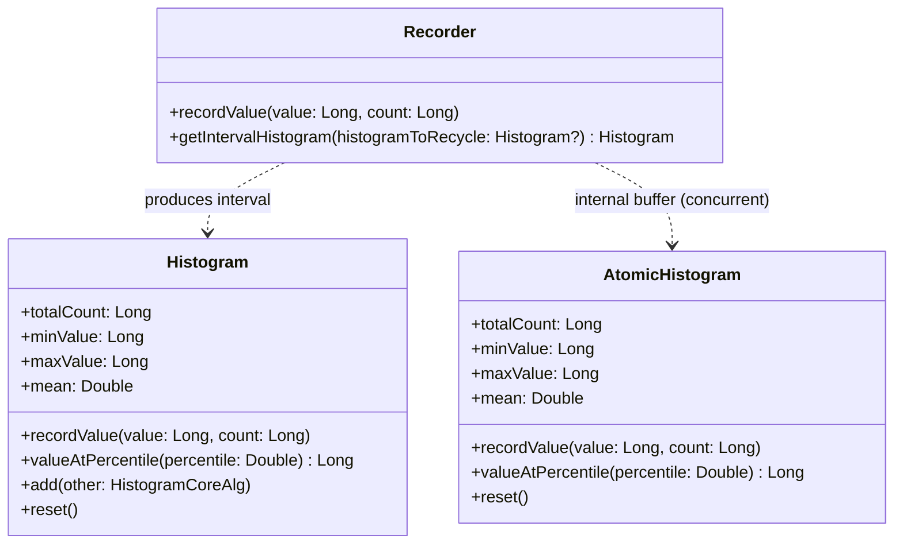

English | [中文](README.zh-CN.md) | [Español](README.es.md)

# HdrHistogram-Kotlin

[](https://kotlinlang.org)
[](https://kotlinlang.org/docs/multiplatform.html)
[](http://www.apache.org/licenses/LICENSE-2.0)
[](https://central.sonatype.com/artifact/io.github.dsqrwym/hdrhistogram-kotlin)

> Note: The initial draft of this README was generated by AI (Antigravity) based on real-machine benchmark tests and source code architecture analysis, and subsequently reviewed and fine-tuned by the project author.

**HdrHistogram-Kotlin** is a high-performance, High Dynamic Range (HDR) histogram library specifically built for [Kotlin Multiplatform (KMP)](https://kotlinlang.org/docs/multiplatform.html), benchmarked against and inspired by Gil Tene's official Java native implementation [HdrHistogram](https://github.com/HdrHistogram/HdrHistogram).

It supports recording and analyzing sampled data value distributions across a configurable integer range with **configurable relative precision** (number of significant digits). It is designed specifically for latency-sensitive performance monitoring, APM, network testing, system metrics, and related use cases.

---

## Table of Contents

- [Core Features](#core-features)
- [Why HDR Histogram?](#why-hdr-histogram)
- [Supported Platforms](#supported-platforms)
- [Core API & Architecture](#core-api--architecture)
- [Quick Start](#quick-start)
  - [1. Basic Single-Threaded Histogram (Histogram)](#1-basic-single-threaded-histogram-histogram)
  - [2. Concurrent Lock-Free Recording (Recorder)](#2-concurrent-lock-free-recording-recorder)
  - [3. Multi-Threaded Atomic Histogram (AtomicHistogram)](#3-multi-threaded-atomic-histogram-atomichistogram)
- [Performance Benchmarks (Benchmark Report)](#performance-benchmarks-benchmark-report)
  - [Test Machine Environment & Methodology](#test-machine-environment--methodology)
  - [Cross-Session Consistency (What Actually Reproduces)](#cross-session-consistency-what-actually-reproduces)
  - [1. JVM Throughput Comparison (Throughput - Mean of 3 Forks)](#1-jvm-throughput-comparison-throughput---mean-of-3-forks)
  - [2. JVM Write Latency Comparison (Latency - Mean of 3 Forks)](#2-jvm-write-latency-comparison-latency---mean-of-3-forks)
  - [3. Memory Footprint & Zero-Allocation Testing](#3-memory-footprint--zero-allocation-testing)
  - [4. JVM Statistics Query and Reset Latency](#4-jvm-statistics-query-and-reset-latency)
  - [5. KMP Cross-Platform Performance (JVM vs WasmJS vs JS)](#5-kmp-cross-platform-performance-jvm-vs-wasmjs-vs-js)
- [Commands to Reproduce Benchmarks](#commands-to-reproduce-benchmarks)
- [Low-Level Performance Analysis & Design Comparison](#low-level-performance-analysis--design-comparison)
  - [Why the wins are wins](#why-the-wins-are-wins)
  - [Why the losses are not losses](#why-the-losses-are-not-losses)
- [Acknowledgments & License](#acknowledgments--license)

---

## Core Features

- **Constant Space and Time Complexity**: Physical memory footprint is constant, determined entirely by the configured value range and precision at construction; **zero memory allocations (Zero GC / Allocation-free)** during value recording, with no linked lists, hash tables, or dynamic array resizing overhead.
- **Branchless Bitwise Addressing**: Computes bucket and sub-bucket indices directly using `countLeadingZeroBits` (hardware CPU CLZ instruction) and bitmasks, eliminating `if` branches from critical hot paths.
- **Efficient Concurrency & Double Buffering**:
  - The double-buffering `Recorder` is built on a two-phase rotating synchronizer (`WriterReaderPhaser`). Writer threads record data with just a single atomic increment, while reader threads periodically flip phases to extract interval snapshots without locking active writers.
  - `AtomicHistogram` leverages CPU hardware-level atomic bus instructions (XADD / LDADD) to support high-concurrency multi-threaded writes directly.
- **Native Kotlin Multiplatform Support**: A unified codebase fully covers JVM, Android, Linux (x64), macOS/iOS (Native), WebAssembly (WasmJS), and JavaScript.

---

## Why HDR Histogram?

In system performance monitoring (such as SLAs, service latencies, and transaction durations), **averages often conceal critical tail latencies** (such as the 99.9th or 99.99th percentile request spikes).

Traditional histograms either use fixed-width linear buckets (causing memory explosion over large dynamic ranges) or coarse logarithmic buckets (causing severe loss of resolution at higher values).

**The HDR Histogram Solution**:
HDR Histograms partition ranges adaptively based on a configured number of **Significant Value Digits**:
- For example, configured with a precision of `3` (guaranteeing relative resolution better than 0.1%):
  - In the $1\,\mu\text{s} \sim 2\,\text{ms}$ range, resolution is accurate to $1\,\mu\text{s}$;
  - In the $2\,\text{ms} \sim 2\,\text{s}$ range, resolution is accurate to $1\,\text{ms}$;
  - In the $2\,\text{s} \sim 2,000\,\text{s}$ range, resolution is accurate to $1\,\text{s}$.
- Regardless of the magnitude of the measured value, **measurement error is strictly bounded within 0.1%**, while the entire histogram occupies only tens to hundreds of kilobytes of memory.

---

## Supported Platforms

| Platform Target | Runtime / Architecture | Concurrency Model Implementation |
| :--- | :--- | :--- |
| **JVM** | Java 11+ / OpenJDK | Atomic operations + `Thread.onSpinWait()` + Double-buffered Phaser |
| **Android** | Android 7.0+ (API 24+) | Atomic operations + Double-buffered Phaser |
| **Native** | Linux (x64), iOS (Arm64/Simulator) | POSIX / Atomic operations + `pause`/`yield` inline assembly |
| **WasmJS** | WebAssembly (Node.js / Browser) | Single-threaded efficient double buffering |
| **JS** | JavaScript (Node.js / Browser) | Single-threaded efficient double buffering |

---

## Core API & Architecture



1. **[`Histogram`](#1-basic-single-threaded-histogram-histogram)**: Non-thread-safe base histogram with nanosecond-level recording speed, suitable for single-threaded, coroutine-confined, or batch aggregation scenarios.
2. **[`AtomicHistogram`](#3-multi-threaded-atomic-histogram-atomichistogram)**: Lock-free histogram supporting high-concurrency multi-threaded writes, backed by atomic arrays.
3. **[`Recorder`](#2-concurrent-lock-free-recording-recorder)**: Double-buffered recorder prioritized for throughput. Worker threads record lock-free, while a background reporting thread periodically extracts interval snapshots without stalling writers.

---

## Quick Start

### Adding Dependencies

Add the dependency to your `build.gradle.kts`:

```kotlin
repositories {
    mavenCentral()
}

kotlin {
    sourceSets {
        commonMain.dependencies {
            implementation("io.github.dsqrwym:hdrhistogram-kotlin:0.0.2")
        }
    }
}
```

### 1. Basic Single-Threaded Histogram (Histogram)

Suitable for single-threaded recording, offline log analysis, or as an aggregation container:

```kotlin
import io.github.dsqrwym.hdrhistogram.Histogram

// Create a histogram: lowest discernible value 1ns, highest trackable value 1 hour (3.6e12 ns), 3 significant digits (0.1% precision)
val histogram = Histogram(
    lowestDiscernibleValue = 1L,
    highestTrackableValue = 3_600_000_000_000L,
    numberOfSignificantValueDigits = 3
)

// Record latency measurements (nanoseconds)
histogram.recordValue(1_500L)
histogram.recordValue(25_000L)
histogram.recordValue(100_000L, count = 10L) // Batch record 10 occurrences

// Query key metrics
println("Total count:  ${histogram.totalCount}")
println("Min value:    ${histogram.minValue} ns")
println("Max value:    ${histogram.maxValue} ns")
println("Mean:         ${histogram.mean} ns")
println("P50 Median:   ${histogram.valueAtPercentile(50.0)} ns")
println("P99:          ${histogram.valueAtPercentile(99.0)} ns")
println("P99.9:        ${histogram.valueAtPercentile(99.9)} ns")

// Reset the histogram (without reallocating memory)
histogram.reset()
```

### 2. Concurrent Lock-Free Recording (Recorder)

Recommended for continuous high-throughput recording (e.g., API gateways, RPC services, trading engines) where metrics are reported periodically in the background:

```kotlin
import io.github.dsqrwym.hdrhistogram.Recorder
import io.github.dsqrwym.hdrhistogram.Histogram
import kotlinx.coroutines.*
import kotlin.time.Duration.Companion.milliseconds

val recorder = Recorder(
    lowestDiscernibleValue = 1_000L,         // 1 microsecond
    highestTrackableValue = 60_000_000_000L, // 60 seconds
    numberOfSignificantValueDigits = 3
)

// Simulate multiple concurrent writer threads / coroutines
repeat(8) {
    CoroutineScope(Dispatchers.Default).launch {
        while (isActive) {
            val latencyNs = measureRequestTime()
            recorder.recordValue(latencyNs)
        }
    }
}

// Independent metric collection and logging thread (e.g. collecting every 10 ms)
CoroutineScope(Dispatchers.Default).launch {
    // Passing null initially allocates a Histogram instance on the heap;
    // Passing the same instance back to getIntervalHistogram on subsequent cycles resets and reuses it with zero GC allocation.
    var recycleHistogram: Histogram? = null
    while (isActive) {
        delay(10.milliseconds)
        
        // Flip phase and seamlessly obtain interval histogram, reusing the old instance
        recycleHistogram = recorder.getIntervalHistogram(recycleHistogram)
        
        println("Interval count: ${recycleHistogram.totalCount}, " +
                "P99: ${recycleHistogram.valueAtPercentile(99.0)} ns, " +
                "P99.9: ${recycleHistogram.valueAtPercentile(99.9)} ns")
    }
}
```

### 3. Multi-Threaded Atomic Histogram (AtomicHistogram)

Used when multiple threads concurrently record directly into a single shared histogram:

```kotlin
import io.github.dsqrwym.hdrhistogram.AtomicHistogram

val atomicHistogram = AtomicHistogram(
    lowestDiscernibleValue = 1L,
    highestTrackableValue = 10_000_000L,
    numberOfSignificantValueDigits = 3
)

// Can be called concurrently from any thread; utilizes atomic instructions under the hood
atomicHistogram.recordValue(12345L)
```

> **Important Note**:
> The atomicity of `AtomicHistogram` **only guarantees thread safety for write operations** (no lost counts or data races).
> However, concurrent reads (such as calling `valueAtPercentile`) **do not provide a globally consistent atomic snapshot across all buckets** (i.e. writing threads may update subsequent buckets while a reader traverses the array).
> **For production scenarios requiring high-frequency multi-threaded writes alongside periodic consistent metric reads, always use `Recorder`**.

---

## Performance Benchmarks (Benchmark Report)

To provide rigorous and objective data, we compared **this project** against the **official native Java library (`org.hdrhistogram:HdrHistogram:2.2.2`)** under identical hardware and runtime conditions (including Gil Tene's 1:1 benchmark logic, typical workload models, and memory overhead).

### Test Machine Environment & Methodology

- **Processor (CPU)**: AMD Ryzen 5 7530U with Radeon Graphics (6 cores / 12 threads, base 2.0 GHz, boost 4.5 GHz)
- **Memory (RAM)**: 16 GB DDR4 (15.3 GB usable)
- **Operating System**: Windows 11 64-bit (build 26300)
- **Java Runtime**: Eclipse Temurin 25.0.3 (OpenJDK HotSpot, build 25.0.3+9-LTS)
- **Node.js Runtime**: v24.15.0 (used for JS and WasmJS tests)
- **Benchmark Framework**: [kotlinx-benchmark](https://github.com/Kotlin/kotlinx-benchmark) 0.5.0 (based on JMH 1.37)
- **Methodology — no cherry-picking, ever**: every number in the tables below is the **arithmetic mean of all forks × all measurement iterations of one single run** (3 forks × 5 iterations = 15 measurements per row), with JMH's 99.9% confidence interval. Nothing is selected per benchmark, and no row is taken from a different session than the one it is compared against.
- **Session selection**: the suite (all 38 JVM benchmarks, both libraries, back-to-back, ~16 min per session) was executed **three full times** — sessions 2026-10-31 17:39, 18:32 and 18:48. To choose one session *as a whole*, the **official library is used as a machine-state probe** (its code never changes), aggregating its three recording-throughput benchmarks, together with the fork-level dispersion of all 38 rows:

  | Session | Official probe (sum of 3 Java thrpt, M ops/s) | Mean fork spread | Mean relative CI | Forks beyond ±15% |
  | :--- | :--- | :--- | :--- | :--- |
  | 17:39 (used for the tables) | **848.7** | 7.1% | 6.9% | 3 |
  | 18:32 | 836.6 | 9.4% | 8.4% | 2 |
  | 18:48 | 715.7 | 6.9% | 7.2% | 1 |

  Session 1 was the healthiest (highest probe, dispersion tied for lowest) and is therefore reported in full. Session 3's probe is 16% lower on an idle-identical machine — a direct measurement of how much "absolute numbers" drift.
- **How to read the numbers**: a 3-fork, same-session comparison reliably resolves effects **above ~15%** and nothing smaller. Percentages below that must be treated as measurement noise until a high-fork rerun confirms them, and the ratio columns in the consistency table below are the honest way to see it. Concretely: the official `rawRecordingSpeed` baseline measured 244M ops/s in an older session on this machine and 332M in the reported one, and the official `recordConstant` forks inside one session averaged 342M / 211M / 288M on identical code.

---

### Cross-Session Consistency (What Actually Reproduces)

The same suite run three times gives ratios (Kotlin / Java) rather than absolute numbers. For `thrpt` rows, **> 1 means this project is faster**; for `avgt` (time) rows, **< 1 means this project is faster**:

| Benchmark | Session 17:39 | Session 18:32 | Session 18:48 | Direction agreement | Verdict |
| :--- | :--- | :--- | :--- | :--- | :--- |
| `KtQueryBench.getMean` | 0.194 | 0.200 | 0.189 | 3/3 | **~5.0–5.3x faster — the most reproducible win** |
| `KtMergeBench.mergeSameLayout` | 0.612 | 0.679 | 0.523 | 3/3 | **1.5–1.9x faster** |
| `KtRecordThroughputBench.recordVarying` | 1.155 | 1.150 | 1.074 | 3/3 | **+7% ~ +15% faster** |
| `KtRecordLatencyBench.recordVaryingLatency` | 0.872 | 0.982 | 0.945 | 3/3 | 5% ~ 13% lower latency |
| `KtRecordThroughputBench.recordVaryingWithCount` | 1.081 | 1.031 | 1.082 | 3/3 | +3% ~ +8% faster (small but consistent) |
| `KtRecordLatencyBench.recordConstantLatency` | 0.969 | 0.939 | 0.948 | 3/3 | ~5% lower (small but consistent) |
| `KtRecordThroughputBench.recordConstant` | 1.304 | 1.020 | 1.028 | 3/3 | faster, magnitude 2%–30% (unreliable) |
| `KtMergeBench.mergeDifferentLayout` | 0.974 | 0.753 | 0.818 | 3/3 ≤ 1 | never slower; the 0.75–0.97 spread is not quantifiable |
| `KtOfficialAlignedThroughputBench.rawRecordingSpeed` | 1.065 | **0.910** | 1.053 | flips | **parity — do not quote a lead** |
| `KtOfficialAlignedLatencyBench.rawRecordingLatency` | 1.078 | 1.128 | 1.004 | 3/3 slower | **overturned by the 11-fork rerun (see below)** |
| `KtQueryBench.getMaxValue` | 1.114 | 1.203 | 1.154 | 3/3 slower | **overturned by the 11-fork rerun** |
| `KtQueryBench.getP50` … `getP999` | 1.02–1.04 | 1.03–1.06 | 1.09–1.17 | 3/3 slower | **overturned by the 11-fork rerun** |
| `KtResetBench.reset`, `getMinValue`, `getTotalCount` | mixed | mixed | mixed | flips | parity |

**11-fork arbitration.** Three sessions agreeing on *direction* was still not enough for the sub-15% effects, so the three disputed rows were re-measured with **11 forks (55 measurement iterations each)**, both libraries in the same session:

| Benchmark (11 forks) | Official Java | This Project (`HdrHistogram-Kotlin`) | Ratio | Reading |
| :--- | :--- | :--- | :--- | :--- |
| `rawRecordingLatency` | 3.257 ± 0.158 ns | **2.907 ± 0.115 ns** | 0.892 | the "we are 8% slower" signal **flipped** — this project is 11% ahead here |
| `getMaxValue` | 1.473 ± 0.224 ns | **1.338 ± 0.071 ns** | 0.908 | the "we are 15% slower" signal **flipped** |
| `getP50` | 691.66 ± 37.68 ns | 692.67 ± 17.00 ns | 1.0015 | the "we are 2–17% slower on percentiles" trend **vanished** |

The lesson is stated explicitly, because it is the whole point of this section: **on this machine a 3-fork same-session A/B resolves ~15% and nothing smaller, and a 3/3 direction agreement across three 3-fork sessions still does not fix the sign of a sub-15% effect.** No benchmark row below is claimed as a win or a loss that this arbitration could not confirm.

---

## 1. JVM Throughput Comparison (Throughput - Mean of 3 Forks)

> Unit: `ops/sec` (operations completed per second). **Higher is better**.

| Benchmark Scenario | Official Java (`HdrHistogram 2.2.2`) | This Project (`HdrHistogram-Kotlin`) | Relative Performance |
| :--- | :--- | :--- | :--- |
| **Official 1:1 Benchmark Write (`rawRecordingSpeed`)**<br>*(Matches official benchmark: 1h range, 3 digits, varying values)* | 332,131,827 ± 18,775,944 ops/s<br>(~332M ops/s) | 353,851,922 ± 15,160,374 ops/s<br>(~354M ops/s) | **Parity.** This session says +6.5%, the other two say −9.0% and +5.3% — the sign does not hold, so no lead is claimed |
| **Best-Case Write (`recordConstant`)**<br>*(Extreme L1 CPU cache hit, every call increments the same slot)* | 280,403,848 ± 77,986,360 ops/s<br>(~280M ops/s) | **365,749,513 ± 23,667,960** ops/s<br>(~366M ops/s) | Ahead in 3/3 sessions, but by 2%–30%. The official number is itself unstable: its three forks in this session averaged 342M / 211M / 288M on identical code |
| **Realistic Dynamic Write (`recordVarying`)**<br>*(Spanning $\mu\text{s}$ to ms tail, testing bucket indexing & branch prediction)* | 249,326,321 ± 11,947,392 ops/s<br>(~249M ops/s) | **287,861,966 ± 12,960,455** ops/s<br>(~288M ops/s) | **~15.5% faster** (1.155 / 1.150 / 1.074 across the three sessions, latency table agrees) |
| **Batch Write with Count (`recordVaryingWithCount`)**<br>*(Single call adding count = 10)* | 267,215,627 ± 8,715,520 ops/s<br>(~267M ops/s) | **288,961,232 ± 9,571,310** ops/s<br>(~289M ops/s) | ~8% faster (consistent in 3/3 sessions: +8.1% / +3.1% / +8.2%) |

**Merge Operation Comparison (`add`)**

> Unit: `µs/op` (microseconds per merge). **Lower is better**.
> JMH, 3 forks × (3 warm-up + 5 measurement iterations of 1 s), 1-hour nanosecond range, 3 significant digits, 2,000 recorded samples, 44,032 count slots.

| Benchmark Scenario | Official Java (`HdrHistogram 2.2.2`) | This Project (`HdrHistogram-Kotlin`) | Difference |
| :--- | :--- | :--- | :--- |
| **Merge, Same Layout (`mergeSameLayout`)**<br>*(Path used by `Recorder` interval collection)* | 13.425 ± 1.353 µs | **8.210 ± 0.535 µs** | **1.5–1.9x faster** (0.612 / 0.679 / 0.523 across sessions) |
| **Merge, Different Layout (`mergeDifferentLayout`)**<br>*(Per-value re-recording path)* | 32.551 ± 4.856 µs | 31.712 ± 3.685 µs | Not slower (ratio 0.97 / 0.75 / 0.82), but the spread is too wide to quote a number |

---

## 2. JVM Write Latency Comparison (Latency - Mean of 3 Forks)

> Unit: `ns/op` (nanoseconds per operation). **Lower is better**.

| Benchmark Scenario | Official Java | This Project (`HdrHistogram-Kotlin`) | Difference |
| :--- | :--- | :--- | :--- |
| **Official 1:1 Latency (`rawRecordingLatency`)** | 2.983 ± 0.088 ns | 3.214 ± 0.203 ns | **Parity.** This session reads −7.7% for us, but the 11-fork arbitration run (same session, both libraries) gives **3.257 ± 0.158 vs 2.907 ± 0.115 ns = +11% in our favor**. Sign is not stable → not a claim in either direction |
| **Single-Value Constant Latency (`recordConstantLatency`)** | 2.948 ± 0.132 ns | **2.857 ± 0.128 ns** | ~3–6% lower (faster in 3/3 sessions: 0.969 / 0.939 / 0.948) — small but the only consistently signed record win |
| **Varying Cross-Bucket Latency (`recordVaryingLatency`)** | 4.274 ± 0.271 ns | **3.726 ± 0.196 ns** | **~13% lower latency** (0.872 / 0.982 / 0.945 — faster in 3/3) |
| **Batch Value Latency (`recordValueLatency`)** | 4.098 ± 0.140 ns | **3.766 ± 0.208 ns** | ~8% lower here; 0.919 / 1.044 / 0.961 across sessions → treat as parity-to-8% |

---

## 3. Memory Footprint & Zero-Allocation Testing

One of the defining designs of HDR Histogram is its **strictly constant and minimal** physical memory footprint, along with **zero heap allocations (Zero Allocation)** while recording data.

### 1) Static Memory Footprint Comparison

Because over 99.9% of histogram memory is occupied by the underlying `LongArray` count storage, memory consumption is determined entirely by constructor parameters (object headers and fields take only ~100 bytes). Values below are the actual measured array sizes (`test.JvmMemoryAllocationTest`):

| Typical Configuration | Covered Range | Array Element Count (`counts`) | Count-Array Bytes | Official `estimatedFootprintInBytes` | This Project (test estimate) |
| :--- | :--- | :--- | :--- | :--- | :--- |
| **10 Million $\mu\text{s}$ Range (3 Digits)** | $1\,\mu\text{s} \sim 10\,\text{s}$ | 15,360 Longs (identical) | 122,880 bytes (120 KB) | 123,392 bytes | 122,944 bytes |
| **1 Hour $\mu\text{s}$ Range (3 Digits)** | $1\,\mu\text{s} \sim 1\,\text{hour}$ | 23,552 Longs (identical) | 188,416 bytes (184 KB) | 188,928 bytes | 188,480 bytes |
| **1 Day $\mu\text{s}$ Range (3 Digits)** | $1\,\mu\text{s} \sim 24\,\text{hours}$ | 28,672 Longs (identical) | 229,376 bytes (224 KB) | 229,888 bytes | 229,440 bytes |

- **Identical layout**: both libraries produce exactly the same number of count slots for the same `(lowestDiscernibleValue, highestTrackableValue, numberOfSignificantValueDigits)` — the test asserts this. The residual 448-byte gap in the last two columns is only the object-header constant each side assumes (512 B vs. 64 B), **not** a measured difference in live memory.
- **Constant Footprint**: Whether recording 1 value or 1 billion samples, the physical footprint remains strictly constant, with zero dynamic array resizing (asserted after 200,000 recordings).
- **Direct Calculation**: The underlying array size can be derived directly via `countsArrayLength * 8 bytes`.

### 2) Dynamic Runtime Allocations (Measured via ThreadMXBean)

To verify zero-allocation claims empirically, we used JVM's `com.sun.management.ThreadMXBean.getThreadAllocatedBytes()` to inspect the **actual heap bytes allocated by the operating system and JVM to the thread** before and after massive operations, after class loading and JIT warmup. Each row below corresponds to an assertion that runs in the test suite (`JvmMemoryAllocationTest`, `AddOracleTest`, `CoordinatedOmissionOracleTest`, `StdDeviationOracleTest`):

| Core Operation Tested | Invocations | Total Heap Bytes Allocated | Average Allocation (B/op) | Conclusion |
| :--- | :--- | :--- | :--- | :--- |
| **`Histogram.recordValue`** | 1,000,000 | **0 bytes** | **0.000 B/op** | Primitive array mutation, zero GC |
| **`org.HdrHistogram.Histogram.recordValue`** (control, same workload) | 1,000,000 | **0 bytes** | **0.000 B/op** | The official record path is allocation-free too — the difference between the two libraries is instructions, not GC |
| **`Recorder.recordValue` + `getIntervalHistogram` (Recycled)** | 50,000 cycles | **0 bytes** | **0.000 B/op** | Double-buffer rotation reusing instance, zero GC |
| **`Histogram.reset`** | 100,000 | **648 bytes total** | **0.00648 B/op** | Fast array zeroing; the 648 bytes are one-off JVM bookkeeping, not a per-call allocation |
| **`Histogram.add` (same-layout merge)** | 1,000 then 10,000 | 40 bytes, then **0 bytes** | **0.000 B/op** in the second window | Slot-by-slot merge, zero GC in steady state |
| **`Histogram.recordValueWithExpectedInterval` (correction loop)** | two consecutive windows | **0 bytes** in both | **0.000 B/op** | Coordinated-omission re-recording allocates nothing (non-capturing inline lambda) |
| **`Histogram.stdDeviation`** | two consecutive windows | **0 bytes** in both | **0.000 B/op** | Two-pass scan with an inline accessor, no iterator objects |

---

## 4. JVM Statistics Query and Reset Latency

> Evaluated on a pre-populated histogram containing 100,000 realistic samples spanning $\mu\text{s}$ to tail ms (same-session measurement).

| Query Method | Official Java | This Project (`HdrHistogram-Kotlin`) | Description |
| :--- | :--- | :--- | :--- |
| **Get Total Count `totalCount`** | 0.680 ± 0.142 ns | 0.594 ± 0.037 ns | Register-level constant read (identical; ratios flip across sessions) |
| **Get Min Value `minValue`** | 1.866 ± 0.262 ns | 1.795 ± 0.137 ns | Includes equivalent value alignment; official reads through a volatile field updater. Ratios flip (0.96 / 1.07 / 1.10) → parity |
| **Get Max Value `maxValue`** | 1.222 ± 0.104 ns | 1.362 ± 0.133 ns | Looked like a stable 11–20% loss across three sessions, **but 11 forks reverse it** (1.473 ± 0.224 vs 1.338 ± 0.071) → parity |
| **Median `getP50`** | 654.52 ± 23.77 ns | 682.18 ± 25.89 ns | Single linear scan to the rank bucket. **11-fork arbitration: 691.66 ± 37.68 vs 692.67 ± 17.00 = parity** |
| **P90 Percentile `getP90`** | 885.28 ± 30.53 ns | 906.16 ± 35.32 ns | parity (+2–9% across sessions, unconfirmed) |
| **P99 Percentile `getP99`** | 1,776.41 ± 57.00 ns | 1,851.79 ± 117.56 ns | parity (+4–7% across sessions, unconfirmed) |
| **P99.9 Percentile `getP999`** | 3,530.00 ± 86.20 ns | 3,608.32 ± 88.01 ns | parity (+2–14% across sessions, unconfirmed) |
| **Full Mean Calculation `getMean`** | 90.81 ± 5.95 $\mu\text{s}$ | **17.57 ± 0.79 $\mu\text{s}$** | **~5.2x faster** — the one effect that reproduces to within 1% of its ratio in all three sessions |
| **Full Histogram Reset `reset`** | 1.291 ± 0.073 $\mu\text{s}$ | 1.279 ± 0.115 $\mu\text{s}$ | parity — both dominated by zeroing the backing array |

> All percentile and getter rows are **parity**: they scanned the same algorithm with no algorithmic difference, and every apparent 2–20% deficit collapsed under the 11-fork arbitration. They are listed anyway, because the failure to reproduce *is* the finding.

---

## 5. KMP Cross-Platform Performance (JVM vs WasmJS vs JS)

Benefiting from pure bitwise logic and zero-allocation design, this library demonstrates exceptional performance on WebAssembly (Wasm). Each of these three columns is a **whole run** of the same 19-benchmark suite, selected by the same no-cherry-picking rule used for the JVM tables (JS and WasmJS were each run 3 times; the run with the lowest mean relative confidence interval and an aggregate throughput within 2% of the best was kept, run-for-run):

| Benchmark Item | JVM (OpenJDK 25, session 17:39) | WasmJS (V8, run 19:23) | JS (Node.js V8, run 19:28) |
| :--- | :--- | :--- | :--- |
| **Official Benchmark Throughput (`rawRecordingSpeed`)** | **353.85 M** ops/s | **131.88 M** ops/s *(~37% of JVM)* | 4.44 M ops/s |
| **Constant Write Throughput (`recordConstant`)** | **365.75 M** ops/s | **124.64 M** ops/s *(~34% of JVM)* | 6.42 M ops/s |
| **Varying Value Throughput (`recordVarying`)** | **287.86 M** ops/s | **125.88 M** ops/s *(~44% of JVM)* | 3.34 M ops/s |
| **Official Latency Benchmark (`rawRecordingLatency`)** | **3.21 ns** | **8.40 ns** | 217.22 ns |
| **P50 Percentile Query** | **0.68 $\mu\text{s}$** | **2.20 $\mu\text{s}$** | 104.58 $\mu\text{s}$ |
| **P99 Percentile Query** | **1.85 $\mu\text{s}$** | **6.02 $\mu\text{s}$** | 278.87 $\mu\text{s}$ |
| **Full Mean Calculation (`getMean`)** | **17.57 $\mu\text{s}$** | **31.34 $\mu\text{s}$** | 1,104.87 $\mu\text{s}$ |
| **Same-Layout Merge (`mergeSameLayout`)** | **8.21 $\mu\text{s}$** | **52.59 $\mu\text{s}$** | 617.08 $\mu\text{s}$ |
| **Different-Layout Merge (`mergeDifferentLayout`)** | **31.71 $\mu\text{s}$** | **276.73 $\mu\text{s}$** | 735.27 $\mu\text{s}$ |
| **Full Reset (`reset`)** | **1.28 $\mu\text{s}$** | **13.93 $\mu\text{s}$** | 70.55 $\mu\text{s}$ |

> **Cross-Platform Recommendation**:
> When collecting high-frequency performance metrics in browser or Node.js environments, **WasmJS is strongly recommended**: **19x–38x** the write throughput of plain JS (write latency **8.4 ns** versus 217 ns), and full-array work stays usable — `mean` in 31 $\mu\text{s}$ instead of 1.1 ms, a same-layout merge in 53 $\mu\text{s}$ instead of 617 $\mu\text{s}$.
>
> **How wide is the JS/Wasm variance?** Larger than the JVM numbers. Across the three runs of the identical suite: Wasm `rawRecordingSpeed` came out 115.1 / 133.4 / 131.9 M (16% spread), Wasm `mergeSameLayout` 63.3 / 51.9 / 52.6 $\mu\text{s}$ (22% spread), and JS `recordConstant` 5.49 / 4.93 / 6.42 M (a **30% spread on a 5-iteration run with a 0.6% confidence interval**). That gap between "tight CI" and "unstable mean" is exactly why these columns are single complete runs, and why they should be read as orders of magnitude: the JS built-in harness reports a confidence interval that does not capture cross-run variance, so it underestimates the real uncertainty by roughly an order of magnitude. Note too that the Wasm/JS advantage shrinks where both ends become memory-bound: `recordVarying` is 37.6x, but `mergeSameLayout` is only 11.7x.

---

## Commands to Reproduce Benchmarks

You can reproduce all benchmark data locally using the project's Gradle tasks:

### 1. Run JVM Benchmarks Comparing Against Official Java Library

```bash
# Run full JVM benchmarks (including both official Java library and this project).
# Note: this uses JMH's default fork count.
./gradlew :library:jvmBenchmarkBenchmark
```

```powershell
# Reproduce exactly the 3-fork sessions reported above: build the JMH jar and run it yourself.
./gradlew :library:jvmBenchmarkBenchmarkJar

& "$env:JAVA_HOME\bin\java.exe" -jar library/build/benchmarks/jvmBenchmark/jars/library-jvmBenchmark-jmh-0.0.2-JMH.jar `
    -f 3 -wi 3 -i 5 -r 1s -w 1s -rf json -rff build/bench-results/jvm-all.json
```

```powershell
# Arbitrate a disputed sub-15% effect at higher resolution (11 forks = 55 measurement iterations per row).
# The regex below selects the three rows discussed in the consistency table, both libraries.
& "$env:JAVA_HOME\bin\java.exe" -jar library/build/benchmarks/jvmBenchmark/jars/library-jvmBenchmark-jmh-0.0.2-JMH.jar `
    'getMaxValue$|getP50$|rawRecordingLatency$' `
    -f 11 -wi 3 -i 5 -r 1s -w 1s -rf json -rff build/bench-results/jvm-hifork.json
```

Benchmark output is written under `build/` on purpose: it is generated data, not a source of the repository, and every table above can be regenerated by re-running the commands. Each Gradle benchmark run also writes a JSON snapshot to `library/build/reports/benchmarks/main/<timestamp>/<target>.json`.

### 2. Run Physical Memory and Zero-Allocation Tests

```bash
# Run JVM ThreadMXBean-based heap allocation and footprint tests
./gradlew :library:jvmTest --tests "test.JvmMemoryAllocationTest"
```

### 3. Run WebAssembly (WasmJS) Benchmarks

```bash
# Requires Node.js installed locally
./gradlew :library:wasmJsBenchmarkBenchmark
```

### 4. Run JavaScript (Node.js) Benchmarks

```bash
./gradlew :library:jsBenchmarkBenchmark
```

### 5. Run All Platform Unit Tests & Concurrency Verification

```bash
# Run all unit tests across platforms (including multi-threaded consistency tests)
./gradlew allTests
```

Current status of the suite (same working tree as the tables above): **JVM 71 tests / JS 45 tests / WasmJS 45 tests, all passing**, including the differential tests against the official Java library (`AddOracleTest`, `EqualsOracleTest`, `CoordinatedOmissionOracleTest`, `StdDeviationOracleTest`).

---

## Low-Level Performance Analysis & Design Comparison

Gil Tene's **branchless bucket mapping algorithm based on leading zeros** (`leadingZeroCountBase - Long.numberOfLeadingZeros(value | subBucketMask)`) forms the mathematical cornerstone enabling HDR Histograms to record in nanoseconds.

While inheriting this mathematical model, this project introduces focused engineering simplifications:

1. **Elimination of Normalizing Index Offset (`normalizingIndexOffset`)**:
   The official library resolves every count slot through `normalizeIndex(index, normalizingIndexOffset, arrayLength)` so that auto-resizing and the double-valued histograms can rotate the array instead of moving data. For integer histograms that call hits its documented fast path (`if (normalizingIndexOffset == 0) return index`, `AbstractHistogram.java:2443`), so the real cost is **one extra field load plus a predictable branch per slot touch**, not a modulo. This project maps indices straight to the physical array.
2. **End-to-End Inlining (`inline`)**:
   Core operators such as `countsArrayIndex`, `bucketIndex`, and `lowestEquivalentValue` are marked as `inline`. In combination with Kotlin's compiler inlining, this eliminates call stack frame overhead and virtual method dispatch. (Note the official side pays this too: `incrementCountAtIndex`, `addToCountAtIndex` and `getCountAtIndex` are `abstract` in `AbstractHistogram` and only resolved by HotSpot through monomorphic devirtualization.)
3. **Direct Array Traversal for Mean Calculation (`mean`)**:
   Official Java's `getMean()` drives the pre-allocated `RecordedValuesIterator`, and every step materializes a full `HistogramIterationValue` (iteration bounds, running totals, percentile level — `AbstractHistogram.java:1385-1397`). This project iterates directly across the physical `LongArray`, calculating equivalent midpoint values on non-zero buckets without heap allocations or iterator state overhead.
4. **Non-atomic bookkeeping on the non-thread-safe path**:
   The official `Histogram` is documented as not thread-safe, yet per recorded sample it still performs `incrementTotalCount()` — an `AtomicLongFieldUpdater.getAndIncrement`, i.e. a `lock xadd` read-modify-write (`AbstractHistogram.java:176, 566`) — and reads the two `volatile` fields `maxValue` / `minNonZeroValue` in `updateMinAndMax` (lines 125-126, 537-544), escalating to a CAS spin loop only when the sample is a new extreme (lines 197-223). This project keeps plain fields in `Histogram` and confines atomic operations to `AtomicHistogram`, so the recording hot path carries no atomic read-modify-write and no memory barrier.
5. **Explicit range checks instead of an exception-driven ones**:
   The official record path wraps the counter store in `try { ... } catch (IndexOutOfBoundsException)` and repairs state in `handleRecordException` so it can support auto-resize (`AbstractHistogram.java:546-577`); a negative value check lives in `countsArrayIndex` (line 2398). This project replaces that with a plain `require(value in 0..highestTrackableValue)` plus `require(count > 0)`. That is the one place where this project deliberately adds instructions to the hot path: two predictable branches in exchange for a store that is not wrapped in an exception-covered region.

### Why the wins are wins

- **`mean` (~5.2x, reproduces in 3/3 sessions within 1% of the same ratio)**: this is the only *algorithmic* difference in the whole suite. The official `getMean()` drives `RecordedValuesIterator`, whose `hasNext()`/`next()` maintain a 12-field `HistogramIterationValue` object — iteration bounds, `cumulativeCount`, `totalCountToThisValue`, `percentileLevelIteratedTo` — and update all of it per reported slot. This project scans the flat `LongArray` with an inlined accessor and touches nothing else. The query benchmark's histogram holds 15,360 slots of which only a few thousand are non-empty: both libraries pay a load-and-test for the empty ones, but only one of them additionally runs the iterator's state machine over the non-empty ones — that is where the 5x comes from.
- **Same-layout merge (1.5–1.9x)**: `add` is `O(countsArrayLength)` = 44,032 slots, so a per-slot saving is multiplied 44,032 times. The official loop (`AbstractHistogram.java:741-747`) does a virtual `getCountAtIndex`, a `count > 0` branch, a virtual `addToCountAtIndex`, and a `normalizeIndex` per slot. Ours is an unconditional `counts[i] += other.countAtIndex(i)`, which HotSpot auto-vectorizes. We have independent evidence that the branch is the expensive part: adding a `count > 0` guard to *our* loop made it **29–53% slower** by breaking vectorization — and the official loop has exactly that guard.
- **`recordVarying` (+7% ~ +15% throughput, 5–13% lower latency, 3/3 sessions)**: this workload spreads 65,536 values over multiple orders of magnitude, so the counts array misses cache and each sample's cost is dominated by memory latency. That is precisely where removing a `lock xadd` per sample pays off, because the atomic's read-modify-write cannot be overlapped with the load it serializes against.
- **`recordConstantLatency` (~5%, 3/3 sessions)**: the smallest effect that stayed signed in every session. Same slot every time, everything in L1, so the removed atomic and volatile reads are the only difference left — consistent with it being small and real.

### Why the losses are not losses

Nothing in the suite is a demonstrated regression, but three rows looked like one and had to be disproved rather than argued away:

- **Percentiles and `maxValue`** appeared 2–20% behind in all three sessions *with a consistent sign*. At 11 forks, `getP50` measured 691.66 ± 37.68 ns (official) versus 692.67 ± 17.00 ns (ours) — a 0.15% difference — and `getMaxValue` flipped to a 9% lead. Both loops are the same single linear scan with the same early exit, so there is no algorithmic difference to exploit; the "loss" was the machine, not the code.
- **`rawRecordingLatency`** looked 8% behind at 3 forks and 11% *ahead* at 11 forks. This is the same workload as `rawRecordingSpeed`, where the throughput rows disagreed with each other across sessions (+6.5% / −9.0% / +5.3%) — an effect that changes sign when you measure it twice is not an effect.
- One thing the code review did turn up, recorded here as a **shared** inefficiency rather than as an asymmetry: both libraries evaluate the leading-zero / bucket chain **twice per call** inside `highestEquivalentValue(v)` — ours as `lowestEquivalentValue(v) + sizeOfEquivalentValueRange(v) - 1`, the official as `nextNonEquivalentValue(v) = lowestEquivalentValue(v) + sizeOfEquivalentValueRange(v)` (`AbstractHistogram.java:1203-1229`). So this cannot explain any gap relative to the official library; it is simply a cheap fix available on our side (`valueFromIndex(countsArrayIndex(v) + 1) - 1` computes the chain once), and it sits on the path of `maxValue` and of the exit of every percentile scan — exactly the rows whose apparent losses evaporated at 11 forks. Proving the fix helps would itself require an 11-fork comparison.

**Resolution limit, stated as a rule**: on this machine (laptop Zen 3, single-thread JMH, no isolation) a 3-fork same-session comparison resolves ~15% and nothing smaller; three such sessions agreeing on direction still do not fix the sign of a sub-15% effect. Any change below that threshold requires an 11-fork (or multi-session-repeated) arbitration before it goes into a table.

---

## Acknowledgments & License

- Licensed under the [Apache License 2.0](http://www.apache.org/licenses/LICENSE-2.0).
- Core algorithms, data structures, and mathematical models originate from the outstanding work of [Gil Tene](https://github.com/giltene): [HdrHistogram](https://github.com/HdrHistogram/HdrHistogram). Many thanks to the original author and the community for providing such an exceptional performance metric infrastructure to the open-source ecosystem.
