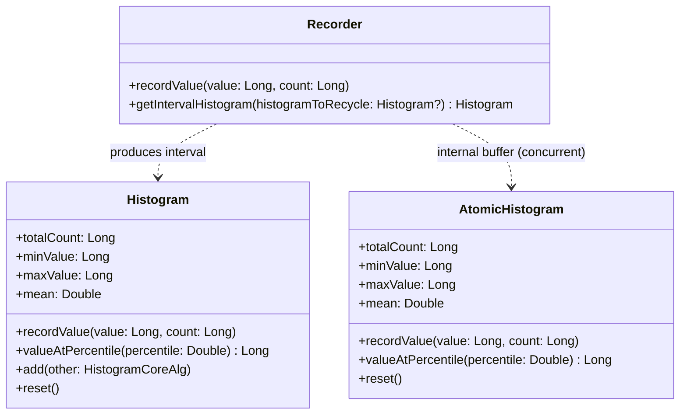

中文 | [English](README.md) | [Español](README.es.md)

# HdrHistogram-Kotlin

[](https://kotlinlang.org)
[](https://kotlinlang.org/docs/multiplatform.html)
[](http://www.apache.org/licenses/LICENSE-2.0)
[](https://central.sonatype.com/artifact/io.github.dsqrwym/hdrhistogram-kotlin)

> 注：本 README 初稿由 AI (Antigravity) 基于实机基准测试与源码架构分析生成，后经项目作者审查与微调。

**HdrHistogram-Kotlin** 是专门为 [Kotlin Multiplatform (KMP)](https://kotlinlang.org/docs/multiplatform.html) 打造的高性能、高动态范围（High Dynamic Range, HDR）直方图库，对标并参考了 Gil Tene 的官方 Java 原生实现 [HdrHistogram](https://github.com/HdrHistogram/HdrHistogram)。

它支持在可配置的整数值范围内，以**可配置的相对精度**（有效数字位数）高效记录并分析采样数据的值分布，专为对延迟敏感的性能监控、APM、网络测试、系统度量等场景设计。

---

## 目录

- [核心特性](#核心特性)
- [为什么需要 HDR 直方图？](#为什么需要-hdr-直方图)
- [支持平台](#支持平台)
- [核心 API 与架构](#核心-api-与架构)
- [快速上手](#快速上手)
  - [1. 基础单线程直方图 (Histogram)](#1-基础单线程直方图-histogram)
  - [2. 并发无锁收集 (Recorder)](#2-并发无锁收集-recorder)
  - [3. 多线程原子直方图 (AtomicHistogram)](#3-多线程原子直方图-atomichistogram)
- [性能对比测试 (基准报告)](#性能对比测试-基准报告)
  - [测试机器环境与方法说明](#测试机器环境与方法说明)
  - [多场一致性（哪些结论真的能复现）](#多场一致性哪些结论真的能复现)
  - [1. JVM 吞吐量对比 (Throughput - 3 fork 均值)](#1-jvm-吞吐量对比-throughput---3-fork-均值)
  - [2. JVM 写入平均延迟 (Latency - 3 fork 均值)](#2-jvm-写入平均延迟-latency---3-fork-均值)
  - [3. 内存占用与零 GC 动态分配测试 (Memory Footprint & Zero Allocation)](#3-内存占用与零-gc-动态分配测试-memory-footprint--zero-allocation)
  - [4. JVM 统计查询与重置耗时](#4-jvm-统计查询与重置耗时)
  - [5. KMP 跨平台运行性能 (JVM vs WasmJS vs JS)](#5-kmp-跨平台运行性能-jvm-vs-wasmjs-vs-js)
- [复现基准测试的命令](#复现基准测试的命令)
- [底层性能分析与设计对比](#底层性能分析与设计对比)
  - [优势为什么是优势](#优势为什么是优势)
  - [劣势为什么不是劣势](#劣势为什么不是劣势)
- [鸣谢与开源协议](#鸣谢与开源协议)

---

## 核心特性

- **常数级空间与时间复杂度**：内存占用大小恒定，完全由构造时配置的值范围与精度决定；在记录数值时**零内存分配 (Zero GC / Allocation-free)**，无任何链表、哈希表查找或动态数组扩容开销。
- **无分支位运算寻址**：利用 `countLeadingZeroBits`（CPU 硬件 CLZ 指令）与位掩码直接计算桶（Bucket）与子桶（Sub-bucket）索引，消除关键热点路径上的 `if` 条件分支。
- **高效并发与双缓冲**：
  - 基于双相位旋转同步器（`WriterReaderPhaser`）实现双缓冲 `Recorder`，写者线程记录数据仅需一次原子递增，读者线程定期翻转相位并无锁提取区间快照。
  - `AtomicHistogram` 利用 CPU 硬件级原子总线指令（XADD / LDADD），支持多线程直接高并发写入。
- **Kotlin Multiplatform 原生支持**：一套通用逻辑全面覆盖 JVM、Android、Linux (x64)、macOS/iOS (Native)、WebAssembly (WasmJS) 与 JavaScript。

---

## 为什么需要 HDR 直方图？

在系统性能监控（如 SLA、接口延迟、交易耗时）中，**平均值往往会掩盖真实的长尾延迟**（例如 99.9% 甚至 99.99% 的请求毛刺）。

传统直方图要么采用固定宽度的线性桶（导致测量大数值跨度时内存爆炸），要么采用粗粒度的对数桶（导致高数值区间精度急剧恶化）。

**HDR 直方图的解决方案**：
以设定的**有效数字位数 (Significant Digits)** 进行自适应对数区间划分：
- 例如配置精度为 `3`（即保证相对分辨率优于 0.1%）：
  - 测量 $1\,\mu\text{s} \sim 2\,\text{ms}$ 区间时，分辨率精准到 $1\,\mu\text{s}$；
  - 测量 $2\,\text{ms} \sim 2\,\text{s}$ 区间时，分辨率精准到 $1\,\text{ms}$；
  - 测量 $2\,\text{s} \sim 2,000\,\text{s}$ 区间时，分辨率精准到 $1\,\text{s}$。
- 无论采样值处于哪个量级，**测量误差始终被严格限制在 0.1% 以内**，同时整张直方图的物理内存仅仅占用数十到数百 KB。

---

## 支持平台

| 平台 Target | 运行时 / 架构 | 并发模型实现 |
| :--- | :--- | :--- |
| **JVM** | Java 11+ / OpenJDK | 原子操作 + `Thread.onSpinWait()` + 双缓冲 Phaser |
| **Android** | Android 7.0+ (API 24+) | 原子操作 + 双缓冲 Phaser |
| **Native** | Linux (x64), iOS (Arm64/Simulator) | POSIX / 原子操作 + `pause`/`yield` 内联汇编 |
| **WasmJS** | WebAssembly (Node.js / 浏览器) | 单线程高效双缓冲 |
| **JS** | JavaScript (Node.js / 浏览器) | 单线程高效双缓冲 |

---

## 核心 API 与架构



1. **[`Histogram`](#1-基础单线程直方图-histogram)**：非线程安全的基础直方图，写入速度极高（纳秒级），适用于单线程、协程独占或批处理汇总场景。
2. **[`AtomicHistogram`](#3-多线程原子直方图-atomichistogram)**：支持多线程高并发写入的无锁直方图，底层基于原子数组。
3. **[`Recorder`](#2-并发无锁收集-recorder)**：吞吐量优先场景的双缓冲记录器。工作线程无锁写入，后台统计线程定期无中断提取区间快照（Interval Histogram）。

---

## 快速上手

### 添加依赖

将依赖添加到你的 `build.gradle.kts` 中：

```kotlin
repositories {
    mavenCentral()
}

kotlin {
    sourceSets {
        commonMain.dependencies {
            implementation("io.github.dsqrwym:hdrhistogram-kotlin:0.0.2")
        }
    }
}
```

### 1. 基础单线程直方图 (Histogram)

适合单线程收集、离线日志分析或作为汇总容器：

```kotlin
import io.github.dsqrwym.hdrhistogram.Histogram

// 创建直方图：最低可辨识值 1ns，最高可追踪值 1小时 (3.6e12 ns)，3 位有效数字 (0.1% 精度)
val histogram = Histogram(
    lowestDiscernibleValue = 1L,
    highestTrackableValue = 3_600_000_000_000L,
    numberOfSignificantValueDigits = 3
)

// 记录延迟测量值 (纳秒)
histogram.recordValue(1_500L)
histogram.recordValue(25_000L)
histogram.recordValue(100_000L, count = 10L) // 批量记录 10 次

// 查询关键指标
println("总采样数: ${histogram.totalCount}")
println("最小值:   ${histogram.minValue} ns")
println("最大值:   ${histogram.maxValue} ns")
println("平均值:   ${histogram.mean} ns")
println("P50中位数: ${histogram.valueAtPercentile(50.0)} ns")
println("P99分位数: ${histogram.valueAtPercentile(99.0)} ns")
println("P99.9分位: ${histogram.valueAtPercentile(99.9)} ns")

// 重置直方图（不重新分配内存）
histogram.reset()
```

### 2. 并发无锁收集 (Recorder)

在需要持续高吞吐记录（如网关、RPC 服务、交易引擎）且后台定期输出指标时，推荐使用 `Recorder`：

```kotlin
import io.github.dsqrwym.hdrhistogram.Recorder
import io.github.dsqrwym.hdrhistogram.Histogram
import kotlinx.coroutines.*
import kotlin.time.Duration.Companion.milliseconds

val recorder = Recorder(
    lowestDiscernibleValue = 1_000L,         // 1 微秒
    highestTrackableValue = 60_000_000_000L, // 60 秒
    numberOfSignificantValueDigits = 3
)

// 模拟多个并发写工作线程 / 协程
repeat(8) {
    CoroutineScope(Dispatchers.Default).launch {
        while (isActive) {
            val latencyNs = measureRequestTime()
            recorder.recordValue(latencyNs)
        }
    }
}

// 独立的指标收集与日志导出线程（例如每 10 毫秒统计一次）
CoroutineScope(Dispatchers.Default).launch {
    // 首次传入 null 会在堆上分配一个 Histogram 实例；
    // 之后每次循环都将同一个实例传回给 getIntervalHistogram，内部会在清零后复用该对象，完全零 GC 分配开销。
    var recycleHistogram: Histogram? = null
    while (isActive) {
        delay(10.milliseconds)
        
        // 翻转相位并无缝获取该时间片内的增量直方图，复用旧实例
        recycleHistogram = recorder.getIntervalHistogram(recycleHistogram)
        
        println("本区间请求数: ${recycleHistogram.totalCount}, " +
                "P99: ${recycleHistogram.valueAtPercentile(99.0)} ns, " +
                "P99.9: ${recycleHistogram.valueAtPercentile(99.9)} ns")
    }
}
```

### 3. 多线程原子直方图 (AtomicHistogram)

用于多个线程直接并发更新同一份统计数据的场景：

```kotlin
import io.github.dsqrwym.hdrhistogram.AtomicHistogram

val atomicHistogram = AtomicHistogram(
    lowestDiscernibleValue = 1L,
    highestTrackableValue = 10_000_000L,
    numberOfSignificantValueDigits = 3
)

// 可以在任意线程并发调用，底层利用 CPU 原子累加指令更新计数
atomicHistogram.recordValue(12345L)
```

> **注意事项（重要）**：
> `AtomicHistogram` 的原子性**仅保证多线程写入时的累加安全**（不丢数据、不产生竞态）。
> 但是，它在并发读取（例如调用 `valueAtPercentile` 计算分位数）时，**不提供跨全部桶的全局原子一致性快照**（即读取操作在遍历数组的过程中，写入线程仍可能在后续桶中递增数值）。
> **对于既需要多线程高频写入，又需要定期读取精准统计指标的生产场景，请务必使用 `Recorder`**。

---

## 性能对比测试 (基准报告)

为了提供严谨客观的技术参考，我们在相同硬件与运行时下，将**本项目**与**官方 Java 原生库 (`org.hdrhistogram:HdrHistogram:2.2.2`)** 进行了完全同等条件下的基准对比测试（包含 Gil Tene 官方给出的 1:1 对标逻辑、常规业务模型及内存开销）。

### 测试机器环境与方法说明

- **处理器 (CPU)**: AMD Ryzen 5 7530U with Radeon Graphics (6 核心 / 12 线程，基准 2.0 GHz，加速 4.5 GHz)
- **内存 (RAM)**: 16 GB DDR4 (15.3 GB 可用)
- **操作系统**: Windows 11 64-bit (build 26300)
- **Java 运行时**: Eclipse Temurin 25.0.3 (OpenJDK HotSpot, build 25.0.3+9-LTS)
- **Node.js 运行时**: v24.15.0 (用于 JS 与 WasmJS 测试)
- **基准测试框架**: [kotlinx-benchmark](https://github.com/Kotlin/kotlinx-benchmark) 0.5.0 (基于 JMH 1.37)
- **测试方法（绝不挑最好）**：下表中每一个数字都是**单次连续运行内全部 fork × 全部测量迭代的算术平均**（每行 = 3 个 fork × 5 轮 = 15 次测量），括号内为 JMH 的 99.9% 置信区间。不存在“某一项从多场里挑最好的一次”，也不存在某一行的对照数据来自另一场。
- **场次选择**：整套基准（38 项，两库，连续跑完约 16 分钟/场）完整执行了**三场**——2026-10-31 的 17:39、18:32、18:48。为了“整场择优”而不是逐行拼凑，用**官方库当机器状态探针**（它的代码自始至终没变），取它三项记录吞吐之和，再配合全场 38 行的 fork 级离散度：

  | 场次 | 官方探针（3 项 Java 吞吐之和，M ops/s） | fork 平均离散度 | 平均相对置信区间 | 超出 ±15% 的 fork 数 |
  | :--- | :--- | :--- | :--- | :--- |
  | 17:39（本表所采用） | **848.7** | 7.1% | 6.9% | 3 |
  | 18:32 | 836.6 | 9.4% | 8.4% | 2 |
  | 18:48 | 715.7 | 6.9% | 7.2% | 1 |

  场 1 状态最好（探针最高、离散度并列最低），因此**整场**采用。场 3 的探针低 16%，而机器空闲状态完全一致——这就是“绝对值跨场不可比”的直接测量。
- **如何阅读数据**：在同一场内做 3-fork A/B 对比，能可靠分辨的效应下限约 **15%**；小于它的百分比在没有高 fork 复核之前一律视为噪声。别以为“三场方向一致”就够了——本文就有一个三场同向、加到 11 forks 后方向反转的例子（见下方一致性小节）。具体到漂移：官方 `rawRecordingSpeed` 基线在这台机器上早先一场 2.44 亿、本报告这场 3.32 亿；而官方 `recordConstant` 在同一场里 3 个 fork 的均值分别是 3.42 亿 / 2.11 亿 / 2.88 亿——跑的是同一份代码。

---

### 多场一致性（哪些结论真的能复现）

同一套基准跑三场，得到的不是绝对值而是比值（本项目 / 官方）。`thrpt` 行 **> 1 表示本项目更快**；`avgt`（耗时）行 **< 1 表示本项目更快**：

| 基准项 | 场 17:39 | 场 18:32 | 场 18:48 | 方向一致性 | 结论 |
| :--- | :--- | :--- | :--- | :--- | :--- |
| `KtQueryBench.getMean` | 0.194 | 0.200 | 0.189 | 3/3 | **快约 5.0~5.3 倍——全套最可复现的收益** |
| `KtMergeBench.mergeSameLayout` | 0.612 | 0.679 | 0.523 | 3/3 | **快 1.5~1.9 倍** |
| `KtRecordThroughputBench.recordVarying` | 1.155 | 1.150 | 1.074 | 3/3 | **快 7%~15%** |
| `KtRecordLatencyBench.recordVaryingLatency` | 0.872 | 0.982 | 0.945 | 3/3 | 延迟低 5%~13% |
| `KtRecordThroughputBench.recordVaryingWithCount` | 1.081 | 1.031 | 1.082 | 3/3 | 快 3%~8%（小但三场同向） |
| `KtRecordLatencyBench.recordConstantLatency` | 0.969 | 0.939 | 0.948 | 3/3 | 低约 5%（小但三场同向） |
| `KtRecordThroughputBench.recordConstant` | 1.304 | 1.020 | 1.028 | 3/3 | 领先，但幅度 2%~30%，不可量化 |
| `KtMergeBench.mergeDifferentLayout` | 0.974 | 0.753 | 0.818 | 3/3 ≤ 1 | 从不更慢；0.75~0.97 的散布不足以给数字 |
| `KtOfficialAlignedThroughputBench.rawRecordingSpeed` | 1.065 | **0.910** | 1.053 | 方向翻转 | **打平——不得声称领先** |
| `KtOfficialAlignedLatencyBench.rawRecordingLatency` | 1.078 | 1.128 | 1.004 | 三场同向偏慢 | **被 11-fork 复核推翻（见下）** |
| `KtQueryBench.getMaxValue` | 1.114 | 1.203 | 1.154 | 三场同向偏慢 | **被 11-fork 复核推翻** |
| `KtQueryBench.getP50` ~ `getP999` | 1.02–1.04 | 1.03–1.06 | 1.09–1.17 | 三场同向偏慢 | **被 11-fork 复核推翻** |
| `KtResetBench.reset`、`getMinValue`、`getTotalCount` | 混合 | 混合 | 混合 | 方向翻转 | 打平 |

**11-fork 仲裁。** 三场方向一致仍不足以裁决 15% 以下的效应，于是把三项有争议的行按 **11 forks（每行 55 次测量迭代）** 重测，同一场内两库对拍：

| 基准项（11 forks） | 官方 Java | 本项目 (`HdrHistogram-Kotlin`) | 比值 | 读数 |
| :--- | :--- | :--- | :--- | :--- |
| `rawRecordingLatency` | 3.257 ± 0.158 ns | **2.907 ± 0.115 ns** | 0.892 | 原本“我们慢 8%”**反转**为本项目快 11% |
| `getMaxValue` | 1.473 ± 0.224 ns | **1.338 ± 0.071 ns** | 0.908 | 原本“我们慢 15%”**反转** |
| `getP50` | 691.66 ± 37.68 ns | 692.67 ± 17.00 ns | 1.0015 | 原本“百分位稳定慢 2~17%”**消失** |

这条教训本身就是本节的目的：**在这台机器上，3-fork 同场对比只能分辨约 15% 以上的效应；三场 3-fork 同向，也定不了一个 15% 以下效应的符号。** 下文任何一行，只要没能通过这套仲裁，就不会被写成“提升”或“落后”。

---

## 1. JVM 吞吐量对比 (Throughput - 3 fork 均值)

> 单位为 `ops/sec`（每秒可完成的记录调用次数），**数值越大性能越好**。

| 测试场景与用例 | 官方 Java 实现 (`HdrHistogram 2.2.2`) | 本项目 Kotlin 实现 (`HdrHistogram-Kotlin`) | 相对表现 |
| :--- | :--- | :--- | :--- |
| **官方 1:1 对标写入 (`rawRecordingSpeed`)**<br>*(与官方基准完全同款：1小时范围, 精度3, 变动数值)* | 332,131,827 ± 18,775,944 ops/s<br>(约 3.32 亿次/秒) | 353,851,922 ± 15,160,374 ops/s<br>(约 3.54 亿次/秒) | **打平。** 本场 +6.5%，另两场 −9.0% 与 +5.3%，符号定不住，因此不声称领先 |
| **最佳情况写入 (`recordConstant`)**<br>*(CPU L1 缓存热点命中，始终累加同一个计数槽)* | 280,403,848 ± 77,986,360 ops/s<br>(约 2.80 亿次/秒) | **365,749,513 ± 23,667,960** ops/s<br>(约 3.66 亿次/秒) | 三场 3/3 领先，但幅度 2%~30%。官方自身就不稳：同一场 3 个 fork 在完全相同的代码上平均 3.42 亿 / 2.11 亿 / 2.88 亿 |
| **现实综合变动写入 (`recordVarying`)**<br>*(跨越微秒到毫秒长尾，测试跨桶寻址与分支预测)* | 249,326,321 ± 11,947,392 ops/s<br>(约 2.49 亿次/秒) | **287,861,966 ± 12,960,455** ops/s<br>(约 2.88 亿次/秒) | **快约 15.5%**（三场比值 1.155 / 1.150 / 1.074，延迟表同向） |
| **带频次批量写入 (`recordVaryingWithCount`)**<br>*(单次调用增加 count = 10)* | 267,215,627 ± 8,715,520 ops/s<br>(约 2.67 亿次/秒) | **288,961,232 ± 9,571,310** ops/s<br>(约 2.89 亿次/秒) | 快约 8%（三场同向：+8.1% / +3.1% / +8.2%） |

**合并操作对比 (`add`)**

> 单位：`µs/op`（单次合并耗时）。**数值越小越好**。
> JMH，3 个 fork ×（3 轮预热 + 5 轮测量，每轮 1 秒），1 小时纳秒量程，3 位有效数字，2,000 个样本，44,032 个计数槽。

| 测试场景 | 官方 Java 实现 (`HdrHistogram 2.2.2`) | 本项目 Kotlin 实现 (`HdrHistogram-Kotlin`) | 差异对比 |
| :--- | :--- | :--- | :--- |
| **同布局合并 (`mergeSameLayout`)**<br>*(`Recorder` 区间收集实际使用的路径)* | 13.425 ± 1.353 µs | **8.210 ± 0.535 µs** | **快 1.5~1.9 倍**（三场比值 0.612 / 0.679 / 0.523） |
| **异构布局合并 (`mergeDifferentLayout`)**<br>*(逐值重录路径)* | 32.551 ± 4.856 µs | 31.712 ± 3.685 µs | 从不更慢（三场比值 0.97 / 0.75 / 0.82），但散布太大，不给具体数字 |

---

## 2. JVM 写入平均延迟 (Latency - 3 fork 均值)

> 单位为 `ns/op`（单次记录操作消耗的纳秒数），**数值越小延迟越低越好**。

| 测试项 | 官方 Java 实现 | 本项目 Kotlin 实现 | 差异对比 |
| :--- | :--- | :--- | :--- |
| **官方 1:1 延迟对标 (`rawRecordingLatency`)** | 2.983 ± 0.088 ns | 3.214 ± 0.203 ns | **打平。** 本场读出我们慢 7.7%，但 11-fork 同场仲裁给出 **3.257 ± 0.158 对 2.907 ± 0.115 ns = 我们快 11%**。符号定不住，两个方向都不写结论 |
| **单值常量记录延迟 (`recordConstantLatency`)** | 2.948 ± 0.132 ns | **2.857 ± 0.128 ns** | 低约 3~6%（三场同向 0.969 / 0.939 / 0.948）——记录路径里唯一三场同号的小胜 |
| **变动跨桶记录延迟 (`recordVaryingLatency`)** | 4.274 ± 0.271 ns | **3.726 ± 0.196 ns** | **低约 13%**（0.872 / 0.982 / 0.945，三场同向） |
| **批量频次记录延迟 (`recordValueLatency`)** | 4.098 ± 0.140 ns | **3.766 ± 0.208 ns** | 本场低约 8%；三场比值 0.919 / 1.044 / 0.961 → 只能写“持平到 8%” |

---

## 3. 内存占用与零 GC 动态分配测试 (Memory Footprint & Zero Allocation)

HDR 直方图最具颠覆性的设计之一在于其**恒定且极小**的物理内存开销，并且在记录数据过程中**完全零堆对象分配 (Zero Allocation)**。

### 1) 物理内存结构推导与对比 (Static Footprint)

由于直方图 99.9% 以上的内存均由存储计数的 `LongArray` 物理数组占据，其占用完全由构造参数决定（对象头及字段仅占约百字节）。下表为 `test.JvmMemoryAllocationTest` 实测的真实数组规模：

| 典型配置规格 | 包含数值区间 | 底层数组元素量 (`counts`) | 计数数组字节数 | 官方 `estimatedFootprintInBytes` | 本项目（测试估算值） |
| :--- | :--- | :--- | :--- | :--- | :--- |
| **1000 万微秒范围 (精度 3)** | $1\,\mu\text{s} \sim 10\,\text{s}$ | 15,360 个 Long（两边完全相同） | 122,880 字节 (120 KB) | 123,392 字节 | 122,944 字节 |
| **1 小时微秒范围 (精度 3)** | $1\,\mu\text{s} \sim 1\,\text{hour}$ | 23,552 个 Long（两边完全相同） | 188,416 字节 (184 KB) | 188,928 字节 | 188,480 字节 |
| **1 天微秒范围 (精度 3)** | $1\,\mu\text{s} \sim 24\,\text{hours}$ | 28,672 个 Long（两边完全相同） | 229,376 字节 (224 KB) | 229,888 字节 | 229,440 字节 |

- **布局完全一致**：相同的 `(lowestDiscernibleValue, highestTrackableValue, numberOfSignificantValueDigits)` 下，两库的计数槽数量一模一样（测试直接断言这一点）。最后两列剩下的 448 字节差额，只是测试里两边各自假定的对象头常数（512 B vs. 64 B），**不是**实测到的存活内存差异。
- **占用恒定**：无论直方图中记录了 1 个值还是 10 亿个样本，物理内存始终保持固定大小，绝不发生动态数组扩容（写入 20 万个值后断言规模未变）。
- **物理数组精确计算**：底层真实开销可通过 `countsArrayLength * 8 字节` 直接推导。

### 2) 运行时动态内存分配严谨实测 (Dynamic Allocations by ThreadMXBean)

为了杜绝理论推导的局限性，我们通过 JVM 底层的 `com.sun.management.ThreadMXBean.getThreadAllocatedBytes()`，在当前工作线程执行大量操作前后直接探测**操作系统与 JVM 实际分配给线程的堆字节数**，排除了类加载与 JIT 预热干扰。下表中每一行都对应测试套件里的一条真实断言（`JvmMemoryAllocationTest`、`AddOracleTest`、`CoordinatedOmissionOracleTest`、`StdDeviationOracleTest`）：

| 被测核心操作 | 执行次数 | 实测总堆分配字节数 | 单次操作平均分配 (B/op) | 结论 |
| :--- | :--- | :--- | :--- | :--- |
| **`Histogram.recordValue`** | 1,000,000 次 | **0 字节** | **0.000 B/op** | 纯基本类型数组累加，完全零 GC |
| **官方 `org.HdrHistogram.Histogram.recordValue`**（同负载对照） | 1,000,000 次 | **0 字节** | **0.000 B/op** | 官方记录路径同样零分配——两库的差别在指令数，不在 GC |
| **`Recorder.recordValue` + `getIntervalHistogram`（容器复用）** | 50,000 轮 | **0 字节** | **0.000 B/op** | 双缓冲翻转复用旧对象，完全零 GC |
| **`Histogram.reset`** | 100,000 次 | **648 字节（合计）** | **0.00648 B/op** | 原生数组填零；648 字节为 JVM 一次性簿记开销，并非每次调用分配 |
| **`Histogram.add`（同布局合并）** | 先 1,000 次再 10,000 次 | 40 字节，随后 **0 字节** | 第二个窗口 **0.000 B/op** | 逐槽合并，稳态零 GC |
| **`Histogram.recordValueWithExpectedInterval`（补点循环）** | 连续两个窗口 | 两个窗口均 **0 字节** | **0.000 B/op** | 协调遗漏补点不产生任何对象（非捕获 inline lambda） |
| **`Histogram.stdDeviation`** | 连续两个窗口 | 两个窗口均 **0 字节** | **0.000 B/op** | 两遍扫描 + 内联取值，不构造迭代器对象 |

---

## 4. JVM 统计查询与重置耗时

> 在预先填入 100,000 条贴合真实分布（微秒到长尾毫秒）样本的直方图上进行统计计算（同一场次测量）。

| 查询方法 | 官方 Java 实现 | 本项目 Kotlin 实现 | 说明 |
| :--- | :--- | :--- | :--- |
| **获取采样总数 `totalCount`** | 0.680 ± 0.142 ns | 0.594 ± 0.037 ns | 寄存器级常数直接返回（三场比值方向翻转 → 打平） |
| **获取最小值 `minValue`** | 1.866 ± 0.262 ns | 1.795 ± 0.137 ns | 包含等价值边界对齐；官方经由 volatile 字段读取。三场比值 0.96 / 1.07 / 1.10 → 打平 |
| **获取最大值 `maxValue`** | 1.222 ± 0.104 ns | 1.362 ± 0.133 ns | 三场都读出来我们慢 11%~20%，**11-fork 复核反转为快 9%**（1.473 ± 0.224 对 1.338 ± 0.071）→ 打平 |
| **中位数分位 `getP50`** | 654.52 ± 23.77 ns | 682.18 ± 25.89 ns | 线性扫描至 Rank 所在子桶。**11-fork 仲裁：691.66 ± 37.68 对 692.67 ± 17.00 → 完全持平** |
| **P90 分位数 `getP90`** | 885.28 ± 30.53 ns | 906.16 ± 35.32 ns | 持平（三场 +2%~+9%，未获复核确认） |
| **P99 分位数 `getP99`** | 1,776.41 ± 57.00 ns | 1,851.79 ± 117.56 ns | 持平（三场 +4%~+7%，未获复核确认） |
| **P99.9 分位数 `getP999`** | 3,530.00 ± 86.20 ns | 3,608.32 ± 88.01 ns | 持平（三场 +2%~+14%，未获复核确认） |
| **全量均值计算 `getMean`** | 90.81 ± 5.95 $\mu\text{s}$ | **17.57 ± 0.79 $\mu\text{s}$** | **快约 5.2 倍**——全套唯一在三场内比值波动不到 1% 的效应 |
| **全量直方图重置 `reset`** | 1.291 ± 0.073 $\mu\text{s}$ | 1.279 ± 0.115 $\mu\text{s}$ | 持平——两侧都被数组清零主导 |

> 所有百分位与 getter 行都是**持平**：两边跑的是同一个线性扫描，没有算法差可利用，三场里读出的 2%~20%“落后”在 11-fork 仲裁下全部塌回噪声。这里仍把它们列出来，因为“复现不出来”本身就是结论。

---

## 5. KMP 跨平台运行性能 (JVM vs WasmJS vs JS)

得益于纯位运算设计与零堆分配架构，本项目在 WebAssembly (Wasm) 平台上同样展现出出色的执行效率。下面三列中的每一列都是同一套 19 项基准的**一整场完整运行**，并按与 JVM 表相同的“不逐行挑选”规则选出（JS 与 WasmJS 各跑 3 场，保留平均相对置信区间最低、且聚合吞吐与最好一场相差 2% 以内的那一场，整场采用）：

| 基准测试项 | JVM (OpenJDK 25，17:39 场) | WasmJS (V8，19:23 场) | JS (Node.js V8，19:28 场) |
| :--- | :--- | :--- | :--- |
| **官方对标吞吐 (`rawRecordingSpeed`)** | **353.85 M** ops/s | **131.88 M** ops/s *(达到 JVM 的 37%)* | 4.44 M ops/s |
| **常量写入吞吐 (`recordConstant`)** | **365.75 M** ops/s | **124.64 M** ops/s *(达到 JVM 的 34%)* | 6.42 M ops/s |
| **变动跨桶吞吐 (`recordVarying`)** | **287.86 M** ops/s | **125.88 M** ops/s *(达到 JVM 的 44%)* | 3.34 M ops/s |
| **官方对标延迟 (`rawRecordingLatency`)** | **3.21 ns** | **8.40 ns** | 217.22 ns |
| **P50 分位数查询** | **0.68 $\mu\text{s}$** | **2.20 $\mu\text{s}$** | 104.58 $\mu\text{s}$ |
| **P99 分位数查询** | **1.85 $\mu\text{s}$** | **6.02 $\mu\text{s}$** | 278.87 $\mu\text{s}$ |
| **全量均值计算 (`getMean`)** | **17.57 $\mu\text{s}$** | **31.34 $\mu\text{s}$** | 1,104.87 $\mu\text{s}$ |
| **同布局合并 (`mergeSameLayout`)** | **8.21 $\mu\text{s}$** | **52.59 $\mu\text{s}$** | 617.08 $\mu\text{s}$ |
| **异构布局合并 (`mergeDifferentLayout`)** | **31.71 $\mu\text{s}$** | **276.73 $\mu\text{s}$** | 735.27 $\mu\text{s}$ |
| **全量重置 (`reset`)** | **1.28 $\mu\text{s}$** | **13.93 $\mu\text{s}$** | 70.55 $\mu\text{s}$ |

> **跨平台选型建议**：
> 在浏览器或 Node.js 环境中高频采集指标时**强烈推荐 WasmJS**：写入吞吐是纯 JS 的 **19~38 倍**（写入延迟 **8.4 ns** 对 217 ns），而且全数组级操作照样能用——`mean` 31 $\mu\text{s}$ 而不是 1.1 ms，同布局合并 53 $\mu\text{s}$ 而不是 617 $\mu\text{s}$。
>
> **JS / Wasm 的场次间波动有多大？** 比 JVM 更大。同一套基准跑三场的实际结果：Wasm `rawRecordingSpeed` 分别为 115.1 / 133.4 / 131.9 M（散布 16%），Wasm `mergeSameLayout` 为 63.3 / 51.9 / 52.6 $\mu\text{s}$（散布 22%），JS `recordConstant` 为 5.49 / 4.93 / 6.42 M——**一场 5 轮测量、置信区间只有 0.6% 的运行，跨场却散布了 30%**。“置信区间很紧”与“均值很不稳”之间的这道缺口，正是这两列必须整场采用、且只能当量级参考的原因：JS 内置执行器报的置信区间不包含跨场方差，它把真实不确定度低估了约一个数量级。另外，当两端都受内存带宽限制时 Wasm 的优势会收窄：`recordVarying` 差 37.6 倍，而 `mergeSameLayout` 只差 11.7 倍。

---

## 复现基准测试的命令

你可以使用项目自带的 Gradle 脚本，在本地复现上述所有对比数据：

### 1. 运行 JVM 端与官方 Java 库的同台性能对比测试

```bash
# 运行完整的 JVM 基准测试（包含官方 Java 库与本项目的对照组）
# 注意：该任务使用 JMH 默认的 fork 数
./gradlew :library:jvmBenchmarkBenchmark
```

```powershell
# 精确复现上文的 3-fork 口径：先打出 JMH jar，再自己带上 -f 3 运行
./gradlew :library:jvmBenchmarkBenchmarkJar

& "$env:JAVA_HOME\bin\java.exe" -jar library/build/benchmarks/jvmBenchmark/jars/library-jvmBenchmark-jmh-0.0.2-JMH.jar `
    -f 3 -wi 3 -i 5 -r 1s -w 1s -rf json -rff build/bench-results/jvm-all.json
```

```powershell
# 对 15% 以下的争议效应做高解析度仲裁（11 forks = 每行 55 次测量迭代），正则只挑上表讨论过的三行
& "$env:JAVA_HOME\bin\java.exe" -jar library/build/benchmarks/jvmBenchmark/jars/library-jvmBenchmark-jmh-0.0.2-JMH.jar `
    'getMaxValue$|getP50$|rawRecordingLatency$' `
    -f 11 -wi 3 -i 5 -r 1s -w 1s -rf json -rff build/bench-results/jvm-hifork.json
```

基准输出刻意落在 `build/` 下：它是生成数据，不是仓库的源文件，上面每一张表都可以用这些命令整场重跑复现。每次通过 Gradle 运行基准，还会在 `library/build/reports/benchmarks/main/<时间戳>/<target>.json` 落一份快照。

### 2. 运行物理内存与零 GC 动态分配测试

```bash
# 运行基于 JVM ThreadMXBean 的真实堆内存分配与物理占用测试
./gradlew :library:jvmTest --tests "test.JvmMemoryAllocationTest"
```

### 3. 运行 WebAssembly (WasmJS) 平台基准测试

```bash
# 需要本机已安装 Node.js
./gradlew :library:wasmJsBenchmarkBenchmark
```

### 4. 运行 JavaScript (Node.js) 平台基准测试

```bash
./gradlew :library:jsBenchmarkBenchmark
```

### 5. 运行全平台单元测试与并发安全性校验

```bash
# 运行所有平台的单元测试（包括高并发下的数据一致性测试）
./gradlew allTests
```

当前测试套件状态（与上表同一份工作树）：**JVM 71 例 / JS 45 例 / WasmJS 45 例，全部通过**，其中包含与官方 Java 库的差分对拍（`AddOracleTest`、`EqualsOracleTest`、`CoordinatedOmissionOracleTest`、`StdDeviationOracleTest`）。

---

## 底层性能分析与设计对比

Gil Tene 在官方 Java 实现中提出的**基于前导零计数的无分支区间映射算法**（`leadingZeroCountBase - Long.numberOfLeadingZeros(value | subBucketMask)`）是 HDR 直方图能够达到纳秒级记录的核心理论基石。

本项目在继承该数学模型的同时，在以下工程细节上进行了针对性精简：

1. **去除标准化偏移计算 (`normalizingIndexOffset`)**：
   官方每次取槽都要过一遍 `normalizeIndex(index, normalizingIndexOffset, arrayLength)`，这是 auto-resize 与浮点直方图“转数组而不搬数据”的基础。整数直方图会命中它的快路径（`if (normalizingIndexOffset == 0) return index`，`AbstractHistogram.java:2443`），所以真实代价是**每触碰一个槽多一次字段读 + 一个可预测分支**，并不是取模。本项目下标直达物理数组。
2. **全链路内联展开 (`inline`)**：
   将 `countsArrayIndex`、`bucketIndex` 以及 `lowestEquivalentValue` 等核心算子标记为 `inline`，配合 Kotlin 编译期的直接展开，消除了方法调用的入栈出栈开销与虚方法分派。（官方也一样付这个成本：`incrementCountAtIndex` / `addToCountAtIndex` / `getCountAtIndex` 在 `AbstractHistogram` 里都是 `abstract`，只能靠 HotSpot 的单态去虚化内联解决。）
3. **均值计算 (`mean`) 的直接数组遍历**：
   官方 Java 的 `getMean()` 驱动预建的 `RecordedValuesIterator`，每前进一步都要维护一整个 `HistogramIterationValue`（迭代边界、累计计数、百分位等级——`AbstractHistogram.java:1385-1397`）；本项目直接在物理 `LongArray` 上通过内联访问器计算各非零区间的中间等价值，减少了堆对象分配与迭代器状态维护的消耗。
4. **非线程安全路径上的非原子簿记**：
   官方 `Histogram` 文档上声明非线程安全，但每个样本仍要执行 `incrementTotalCount()`——即 `AtomicLongFieldUpdater.getAndIncrement`，x86/x64 上就是一次 `lock xadd` 读改写（`AbstractHistogram.java:176, 566`）——并在 `updateMinAndMax` 里读两个 `volatile` 字段 `maxValue` / `minNonZeroValue`（第 125-126、537-544 行），只有出现新极值时才升级到 CAS 自旋（第 197-223 行）。本项目把普通字段留给 `Histogram`，原子操作全部收敛到 `AtomicHistogram`，记录热路径上没有原子读写修改与内存屏障。
5. **显式范围校验取代异常驱动校验**：
   官方把计数存储包在 `try { ... } catch (IndexOutOfBoundsException)` 里，越界后进 `handleRecordException` 修复状态以支持 auto-resize（`AbstractHistogram.java:546-577`），负值判断则在 `countsArrayIndex`（第 2398 行）。本项目改为显式 `require(value in 0..highestTrackableValue)` + `require(count > 0)`。**这是本项目唯一主动往热路径加指令的地方**：用两个可预测分支，换一个不被异常表覆盖的存储。

### 优势为什么是优势

- **`mean`（约 5.2 倍，三场比值波动不到 1%）**：这是全套基准里唯一的**算法级**差异。官方 `getMean()` 驱动 `RecordedValuesIterator`，其 `hasNext()/next()` 要维护一个 12 字段的 `HistogramIterationValue` 对象（迭代边界、`cumulativeCount`、`totalCountToThisValue`、`percentileLevelIteratedTo`），每报一个槽就全部更新一遍；本项目用内联访问器直接扫扁平 `LongArray`，不碰任何其他状态。查询用例里的直方图共 15,360 槽，其中只有几千个非空：为零槽付“读一次 + 判一次”是两库共同的代价，但只有其中一家还要在非空槽上额外跑一遍迭代器状态机——5 倍差距就出在这里。
- **同布局合并（1.5~1.9 倍）**：`add` 是 `O(countsArrayLength)` = 44,032 槽，单槽节省会被放大四万多倍。官方循环（`AbstractHistogram.java:741-747`）每槽要做：虚方法 `getCountAtIndex` → `count > 0` 分支 → 虚方法 `addToCountAtIndex` → `normalizeIndex`。本项目是无条件的 `counts[i] += other.countAtIndex(i)`，HotSpot 可向量化。**分支才是贵的部分，这一点有独立证据**：给本项目的循环加上 `count > 0` 判断，反而慢 29%~53%（向量化被破坏）——而官方循环天生就带着这个判断。
- **`recordVarying`（吞吐 +7%~+15%，延迟低 5%~13%，三场同向）**：该负载把 65,536 个值铺在多个数量级上，计数数组必然缓存缺失，单次记录的成本由内存延迟主导。正是在这种场景下，省掉“每样本一次 `lock xadd`”才真正兑现——原子读改写无法与它所序列化的 load 重叠。
- **`recordConstantLatency`（约 5%，三场同向）**：三场里唯一保持同号的最小效应。每次都命中同一个槽、全在 L1 里，此时被省掉的原子操作与 volatile 读就是全部差异所在——它小，但方向稳定，与机制自洽。

### 劣势为什么不是劣势

整套基准里没有任何一项被证实的回归，但有三行曾经看起来像，而且必须用复测推翻、不能靠解释糊过去：

- **百分位与 `maxValue`**：三场里都稳定慢 2%~20%，且**符号一致**。加到 11 forks 后，`getP50` 测得 691.66 ± 37.68 ns（官方）对 692.67 ± 17.00 ns（本项目），差 0.15%；`getMaxValue` 反转为快 9%。两边是同一个“线性扫描 + 同样的提前退出”，没有算法差可利用——那所谓“落后”来自机器，不是代码。
- **`rawRecordingLatency`**：3 forks 时慢 8%，11 forks 时**快 11%**。它与 `rawRecordingSpeed` 是同一负载，而吞吐那几行在三场之间自身就不一致（+6.5% / −9.0% / +5.3%）——一个测两次就变号的效应，不是效应。
- 代码走查确实找出一处值得记录的点，但它是**两边共有**的低效，不是不对称：两库在 `highestEquivalentValue(v)` 里都把前导零 / 桶链**每次调用算两遍**——我们是 `lowestEquivalentValue(v) + sizeOfEquivalentValueRange(v) - 1`，官方是 `nextNonEquivalentValue(v) = lowestEquivalentValue(v) + sizeOfEquivalentValueRange(v)`（`AbstractHistogram.java:1203-1229`）。所以它解释不了任何相对官方的差距；它只是我们这边一个廉价的待优化点（写成 `valueFromIndex(countsArrayIndex(v) + 1) - 1` 就只算一遍），位置正好在 `maxValue` 与每次百分位扫描的出口上——也就是上面那几行“11 forks 后消失”的读数所在。要证明这个改动确实有益，同样得用 11 forks 来比。

**把分辨上限写成规则**：在这台机器上（笔记本 Zen 3、单线程 JMH、无隔离），3-fork 同场对比只能可靠分辨 **约 15% 以上**的效应；三场 3-fork 同向，也定不了一个 15% 以下效应的符号。低于该门槛的任何变化，必须先进 11-fork（或多场重复）仲裁，才能写进表格。

---

## 鸣谢与开源协议

- 本项目基于 [Apache License 2.0](http://www.apache.org/licenses/LICENSE-2.0) 协议开源。
- 核心算法、数据结构与数学模型源于 [Gil Tene](https://github.com/giltene) 的杰出工作：[HdrHistogram](https://github.com/HdrHistogram/HdrHistogram)。感谢原作者及其社区为行业开源了如此优秀的性能度量基础设施。
